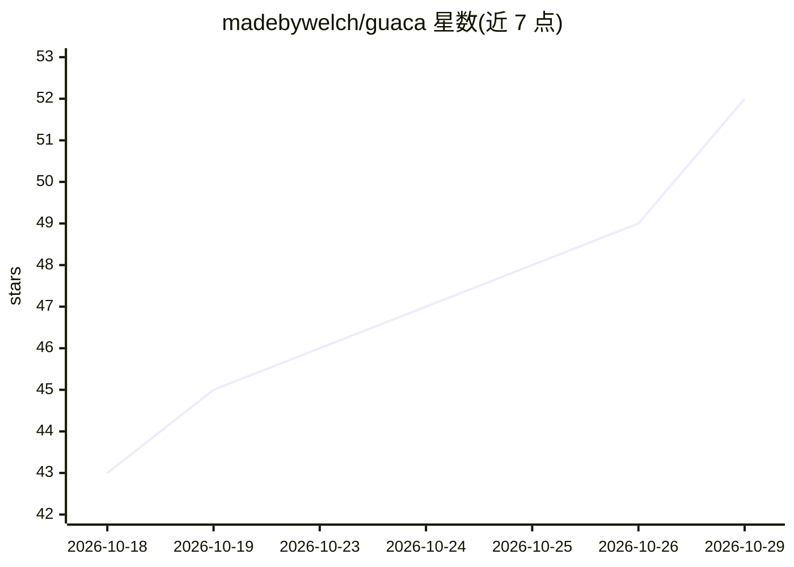

# madebywelch/guaca

⭐ 52 · Rust · AGPL-3.0 · 推送 2026-10-19 · [GitHub](https://github.com/madebywelch/guaca) · [官网](https://guaca.bot/) · 个人维护

**让多个 AI agent 协作工作的自托管桌面工作区**

基于 Tauri/Rust/React 的桌面应用：将 AI agent 组织为隔离的 group，agent 之间可通信、委派任务、保留各自记忆与工作笔记，并通过 MCP 插件连接外部服务。后端 workspace 运行于容器，可部署在本地或自有 VPS，桌面端作为窗口连接。浏览器能力经 Kernel、虚拟计算机经 E2B（需对应厂商 API key）。消息层设计参考 MCP/ACP/A2A/ANP 四种 agent 互操作协议。目前桌面端仅支持 macOS，需从源码构建（Node.js、pnpm、Rust、Xcode CLI），本地 workspace 需 Docker。AGPL v3 许可。

## 筛选速览

| 维度 | 判定 | 备注 |
|---|---|---|
| AI 角色 | `ai-native` | 本体是模型或模型工具 |
| 许可风险 | `viral` | AGPL-3.0 |
| 部署形态 | `None` |  |
| 模型依赖 | — | README 未给出锁定关系 |
| 硬件要求 | — | 无带数字的原话,不猜 |
| 安装摩擦 | `low` | 无编译、无系统依赖或容器化 |
| 成熟度 | `idea` | |

## 能力要点

- agent 分组隔离管理，组内含独立 agent、设置与插件
- 插件为 MCP server，可控制各 agent 的插件与工具权限
- workspace 容器化，可本地运行或连接 VPS 持续运行
- 消息层设计参考 MCP/ACP/A2A/ANP 互操作协议

## 适用场景

- 在自己电脑或 VPS 上搭建多个协作 AI agent 的工作区
- 通过 MCP 插件让 agent 接入外部服务
- 让 agent 在关闭笔记本后于服务器上继续工作

## 场景标签

`多智能体` · 领域:Agent 开发

## 证据(README 行号)

> L3: **A desktop app for AI agents that work together.**
> L14: Organize your agents into **groups**: isolated spaces with their own collection

## 星数曲线

2026-10-18 43 → 2026-10-29 52（+9）

---
*卡片 v1 · prompt 1.4 · 生成 2026-10-25 · 置信度 high · 依据 README sha `54edffb53e55` · [字段定义](../../DATASET.md)*
