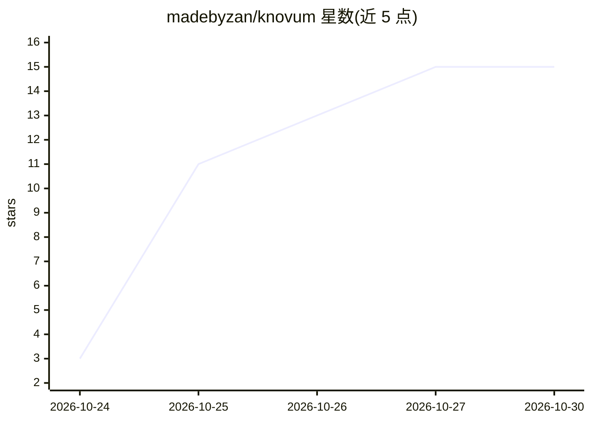

# madebyzan/knovum

⭐ 15 · Rust · NOASSERTION · 推送 2026-10-29 · [GitHub](https://github.com/madebyzan/knovum) · [官网](https://github.com/madebyzan/knovum) · 个人维护 · 中文 README

**本地优先的 AI 知识工作台：无限画布+设备端 AI**

基于 Tauri 2 + Vue 3 + Rust 的桌面知识工作区：无限画布承载笔记、网页捕获、PDF/Office 文档、音视频与代码；本地 SQLite + LanceDB 存储，语义检索与 12 项端侧能力（Whisper 转录、说话人分离、TTS 与声音克隆、抠图、超分、修复、深度估计等）在设备上运行。Ask 功能基于自有资料生成带引用的回答，每个产出记录溯源链。云端模型为可选接入，图像/视频生成为云能力。目前从源码构建，需 Node.js 22.13+、Rust 工具链及 CMake/Protobuf/LLVM 等原生依赖；Linux 与 Windows-on-ARM 不在发布范围。

## 筛选速览

| 维度 | 判定 | 备注 |
|---|---|---|
| AI 角色 | `ai-native` | 本体是模型或模型工具 |
| 许可风险 | `none` | NOASSERTION |
| 部署形态 | `library` | 以包/库形式分发 |
| 模型依赖 | local-ok | 支持本地模型 |
| 硬件要求 | — | 无带数字的原话,不猜 |
| 安装摩擦 | `low` | 无编译、无系统依赖或容器化 |
| 成熟度 | — | 结构信号不足 |

## 能力要点

- 无限画布 + 六类知识对象与十种关系构成的知识图谱，含 Knowledge Health 一致性检查
- 12 项端侧 AI 能力（Whisper/说话人分离/TTS/抠图/超分/深度估计等），Apple Silicon 上 Metal 加速
- 带引用溯源的问答，引用可精确到录音时间区间、PDF 页码、代码行号
- 内置 Agent、ACP 桌面 Agent、双向 MCP 与 Skills/插件扩展

## 适用场景

- 把会议录音、文章、笔记集中在一块画布上做研究与整理
- 对自有资料提问并获得可溯源的引用回答
- 端侧转录、配音、抠图、超分等媒体处理
- 用知识图谱组织论证：声明、证据、决策及其关系检查

## 场景标签

`知识库管理` `知识图谱` `文档问答` · 领域:知识与检索

## 证据(README 行号)

> L8:  Ask questions with cited answers, transcribe and synthesize speech on-device, produce documents,
> L30: sources, ideas, and creations, backed by structured knowledge, on-device AI, and a recorded chain of

## 星数曲线

2026-10-24 3 → 2026-10-30 15（+12）

---
*卡片 v1 · prompt 1.4 · 生成 2026-10-30 · 置信度 high · 依据 README sha `d6ee5bdc6984` · [字段定义](../../DATASET.md)*
