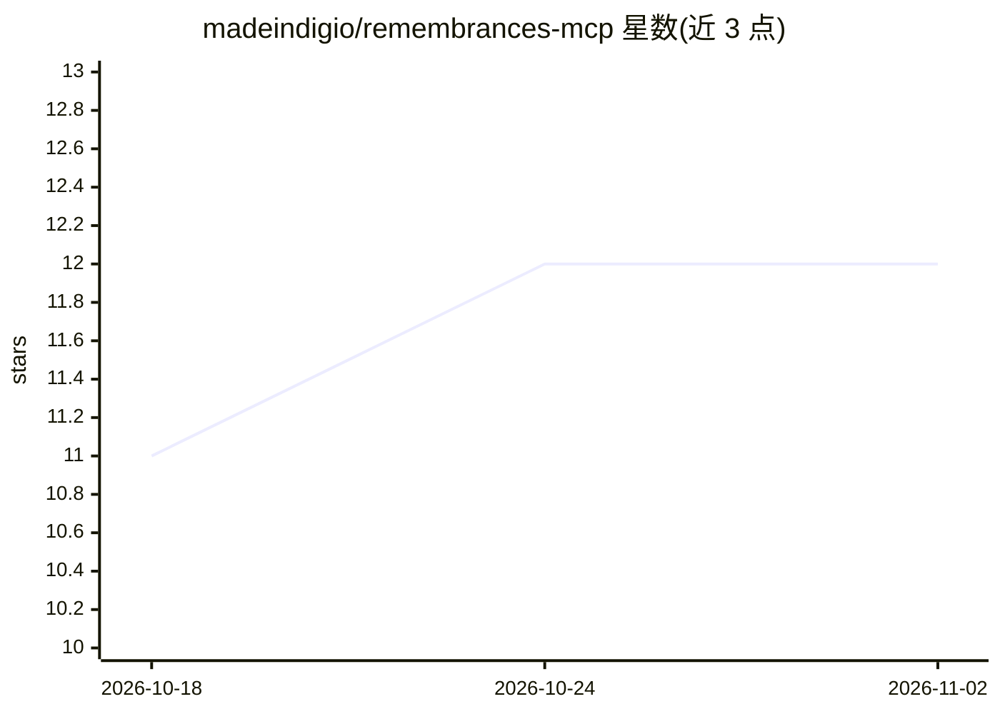

# madeindigio/remembrances-mcp

⭐ 12 · Go · MIT · 推送 2026-09-29 · [GitHub](https://github.com/madeindigio/remembrances-mcp) · [官网](https://madeindigio.github.io/remembrances-mcp/) · 组织维护

**Go 编写的 MCP 服务器：为 AI agent 提供多层长期记忆**

基于 Go 的 MCP 服务器，为 AI agent 提供长期记忆能力：通过 SurrealDB（内嵌或外接）支持键值、向量/RAG、图数据库多层记忆，并可管理 Markdown 知识库。嵌入生成支持三种后端：本地 GGUF 模型（编译 llama.cpp，GPU 加速可选）、Ollama 与 OpenAI API。另含基于 Tree-sitter 的代码索引系统（14+ 语言 AST 解析与语义检索）、按需工具文档（how_to_use）。传输方式支持 stdio、MCP Streamable HTTP 与 HTTP JSON API。README 声明旧线（user_id 参数、SurrealDB 2.x 等）将于 v1（2026-12-15）停止支持。

## 筛选速览

| 维度 | 判定 | 备注 |
|---|---|---|
| AI 角色 | `ai-ecosystem` | LLM/agent 周边工具 |
| 许可风险 | `permissive` | MIT |
| 部署形态 | `None` |  |
| 模型依赖 | local-ok | 支持本地模型 |
| 硬件要求 | — | 无带数字的原话,不猜 |
| 安装摩擦 | `medium` | 含编译或系统依赖之一 |
| 成熟度 | — | 结构信号不足 |

## 能力要点

- 多层记忆：键值、向量/RAG、图数据库，基于 SurrealDB（内嵌或外接）
- 嵌入生成三后端：本地 GGUF（隐私优先、Metal/CUDA/ROCm 加速）、Ollama、OpenAI API
- Tree-sitter 代码索引：14+ 语言 AST 解析、语义搜索与符号重命名
- 三种传输：stdio（默认）、MCP Streamable HTTP、HTTP JSON API，可同时运行

## 适用场景

- 为我的 AI 助手/agent 接入跨会话的长期记忆
- 本地 GGUF 嵌入保证记忆数据不出本机
- 让 agent 索引并语义检索我的代码库
- 用 Markdown 文件维护 agent 的知识库

## 场景标签

`Agent 记忆` `语义搜索` · 领域:Agent 开发

## 证据(README 行号)

> L3: Remembrances-MCP is a Go-based MCP server that provides long-term memory capabilities to AI agents. It supports mult
> L7: - MCP server for AI agent memory

## 星数曲线

2026-10-18 11 → 2026-11-02 12（+1）

---
*卡片 v1 · prompt 1.4 · 生成 2026-11-01 · 置信度 high · 依据 README sha `f403188be8ea` · [字段定义](../../DATASET.md)*
