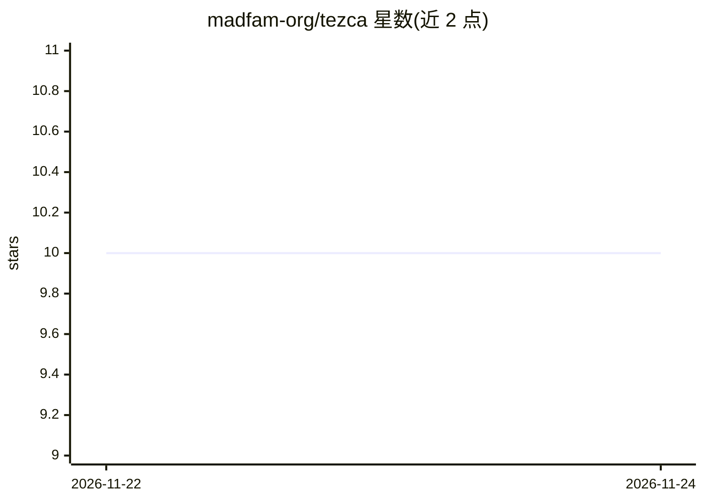

# madfam-org/tezca

⭐ 10 · Python · AGPL-3.0 · 推送 2026-11-23 · [GitHub](https://github.com/madfam-org/tezca) · [官网](https://tezca.mx) · 组织维护

**面向墨西哥法律场景的法律数据平台：30,000+ 部法律可检索可机读**

提供墨西哥联邦、州、市级法律的机器可读数据库，覆盖 11,696 部立法类法律（93.9%）共 30,343 部，350 万+ 条条文以 Elasticsearch 全文索引。技术栈为 Django API + Next.js 前端 + PostgreSQL/Redis/Elasticsearch + Celery，以 Akoma Ntoso XML 结构化输出。提供 REST API、OpenAPI 文档、TypeScript SDK、MCP server、API key 分级限流与 webhook；内置 RAG 聊天（Selva）。界面支持西班牙语/英语/古典纳瓦特尔语。面向公民、会计、律师、合规团队及 AI agent。

## 筛选速览

| 维度 | 判定 | 备注 |
|---|---|---|
| AI 角色 | `ai-enhanced` | 去掉 AI 部分产品仍成立 |
| 许可风险 | `viral` | AGPL-3.0 |
| 部署形态 | `self-host` | docker 或自建部署 |
| 模型依赖 | — | README 未给出锁定关系 |
| 硬件要求 | — | 无带数字的原话,不猜 |
| 安装摩擦 | `low` | 无编译、无系统依赖或容器化 |
| 成熟度 | — | 结构信号不足 |

## 能力要点

- 30,343 部法律、110 万+ 条条文的 Elasticsearch 全文与分面检索
- REST API + OpenAPI 文档 + TypeScript SDK + MCP server，机器可读访问
- 6 种格式导出（TXT/PDF/LaTeX/DOCX/EPUB/JSON）与逐词版本对比
- 内置 RAG 聊天与 llms.txt agent 摘要文件

## 适用场景

- 查询墨西哥某州/联邦法律在特定日期的有效条文
- 为法律科技应用接入机器可读的墨西哥法律数据 API
- 合规团队批量同步法律更新与财税数值表
- 通过聊天界面用自然语言检索法律条文

## 场景标签

`RAG` `语义搜索` · 领域:知识与检索

## 证据(README 行号)

> L7: **The definitive digital platform for Mexican legal research** - comprehensive, machine-readable database of Mexican
> L64: - ✅ **REST API** - Machine-readable access for legal tech (paginated, filtered, rate-limited)
> L73: - ✅ **Trilingual UI** - ES/EN/NAH (Classical Nahuatl) language toggle across all components (law content remains Sp

## 星数曲线

2026-11-22 10 → 2026-11-24 10（+0）

---
*卡片 v1 · prompt 1.4 · 生成 2026-11-22 · 置信度 mid · 依据 README sha `c42b7bab4d9b` · [字段定义](../../DATASET.md)*
