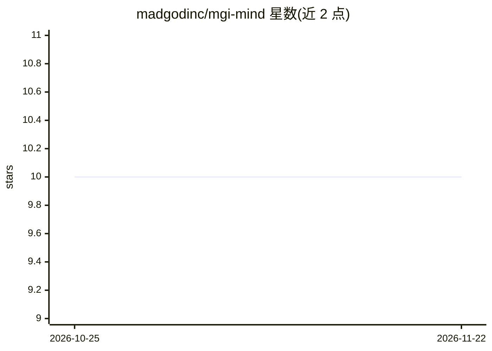

# madgodinc/mgi-mind

⭐ 10 · Rust · Apache-2.0 · 推送 2026-11-13 · [GitHub](https://github.com/madgodinc/mgi-mind) · 个人维护

**给 AI 助手提供本地长期记忆的 MCP 服务器**

用 Rust 编写的单二进制 MCP 服务器，配合本地 Qdrant 向量库与本地 ONNX 模型运行，供 Claude Code 等助手通过 MCP 读写记忆，也可作为普通 CLI 使用。检索侧采用混合搜索（dense 多语言 e5 嵌入 + sparse TF-IDF，RRF 融合）加 bge-reranker-base 交叉编码重排，并包含知识图、按 agent 会话日志、加密 vault。核心机制是有效性模型：duel 规则处理矛盾事实、doubt window 追踪上下文漂移、双时间轴事实、typed outcome 信号；这些机制的调优常数仍在校准中。全部数据本地处理，无云账户、无 API key、无遥测。

## 筛选速览

| 维度 | 判定 | 备注 |
|---|---|---|
| AI 角色 | `ai-ecosystem` | LLM/agent 周边工具 |
| 许可风险 | `permissive` | Apache-2.0 |
| 部署形态 | `desktop` | 安装包/桌面程序 |
| 模型依赖 | — | README 未给出锁定关系 |
| 硬件要求 | — | 无带数字的原话,不猜 |
| 安装摩擦 | `low` | 无编译、无系统依赖或容器化 |
| 成熟度 | — | 结构信号不足 |

## 能力要点

- 混合检索：dense(e5)+sparse(BM25 风格) 经 RRF 融合后由 bge-reranker-base 重排
- 有效性模型：duel 规则、doubt window、双时间轴、outcome 信号管理矛盾与失效事实
- MCP 服务器常驻进程，模型加载一次后查询为毫秒级
- 完全本地运行，无 API key 与遥测

## 适用场景

- 让助手跨会话记住部署配置、决策与修复方案
- 管理事实随时间变化的新旧版本（point-in-time 查询）
- 在本地保存助手记忆且数据不出机器

## 场景标签

`Agent 记忆` `知识图谱` `语义搜索` · 领域:Agent 开发

## 证据(README 行号)

> L9: Local long-term memory for AI assistants. One Rust binary, a local Qdrant
> L52: - **One warm process.** `mgimind mcp` is the MCP server itself: it runs
> L35: MGI-Mind sits between you and your assistant. The assistant writes short

## 星数曲线

2026-10-25 10 → 2026-11-22 10（+0）

---
*卡片 v1 · prompt 1.4 · 生成 2026-11-19 · 置信度 mid · 依据 README sha `77e3fb99013f` · [字段定义](../../DATASET.md)*
