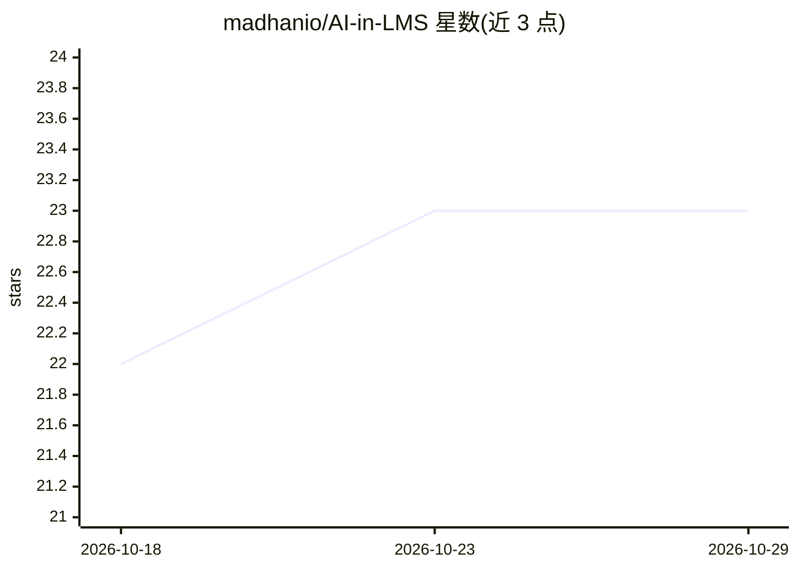

# madhanio/AI-in-LMS

⭐ 23 · Dart · 推送 2026-07-14 · [GitHub](https://github.com/madhanio/AI-in-LMS) · 个人维护

**Moodle 集成的 RAG 学术答疑助手，含 Flutter 移动端**

面向学生的 RAG 问答系统：解析课程材料（PDF/DOCX）并经 NVIDIA NIM 生成 1024 维向量存入 Supabase pgvector；查询按意图分类路由到向量检索、SQL 日历查询或 LMS API，由 NVIDIA NIM LLM 合成答案，经 SSE 流式推送到 Flutter 移动端，附带管理后台上传文档与配置模型。部署采用 Docker 容器，通过 GitHub Webhook→Jenkins 六阶段 CI/CD 流水线发布到 AWS EC2。README 未给出完整本地安装步骤，仅描述容器化部署配置。

## 筛选速览

| 维度 | 判定 | 备注 |
|---|---|---|
| AI 角色 | `ai-native` | 本体是模型或模型工具 |
| 许可风险 | `none` | — |
| 部署形态 | `self-host` | docker 或自建部署 |
| 模型依赖 | — | README 未给出锁定关系 |
| 硬件要求 | — | 无带数字的原话,不猜 |
| 安装摩擦 | `low` | 无编译、无系统依赖或容器化 |
| 成熟度 | — | 结构信号不足 |

## 能力要点

- PDF/DOCX 课程材料向量化并入库 Supabase pgvector
- 意图分类动态路由：向量检索/SQL 日历/LMS API
- SSE 逐 token 流式输出并附来源引用
- GitHub→Jenkins→Docker 六阶段 CI/CD 部署于 AWS EC2

## 适用场景

- 学生通过移动端就课程材料提问并获得带来源的回答
- 查询校历安排与个人学业数据
- 管理员上传课程文档并配置模型

## 场景标签

`RAG` `文档问答` · 领域:知识与检索

## 证据(README 行号)

> L3: A RAG (Retrieval-Augmented Generation) pipeline embedded in a Moodle-integrated LMS that answers student queries usi
> L16: - **Smart Q&A Retrieval:** Extracts and vectorizes multi-format course materials (PDF, DOCX) via NVIDIA NIM.
> L30: 4. **LLM Generation:** NVIDIA NIM LLM synthesizes an answer using the retrieved context.

## 星数曲线

2026-10-18 22 → 2026-10-29 23（+1）

---
*卡片 v1 · prompt 1.4 · 生成 2026-10-27 · 置信度 high · 依据 README sha `785eef96f473` · [字段定义](../../DATASET.md)*
