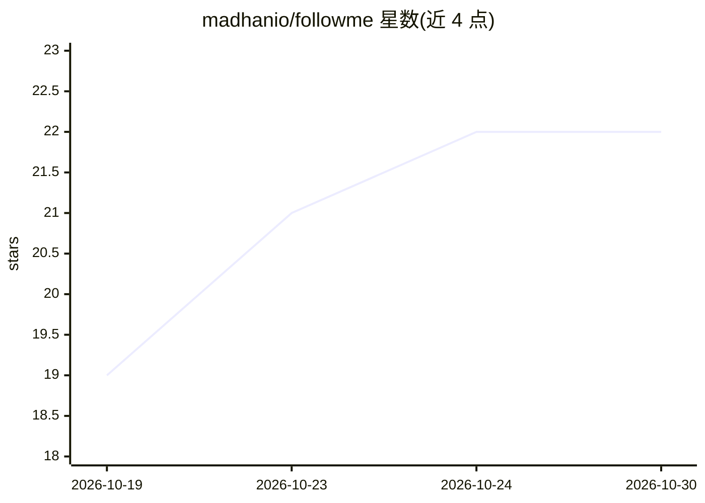

# madhanio/followme

⭐ 22 · TypeScript · MIT · 推送 2026-10-29 · [GitHub](https://github.com/madhanio/followme) · [官网](https://followme-landing.vercel.app) · 个人维护

**自动发现并评估 GitHub 仓库的开发者社交增长工具**

FollowMe 是一个 GitHub 仓库自动发现与开发者社区互动工具：持续搜索技术栈匹配的新建仓库，用 NVIDIA NIM 与 Groq 的 LLM 对代码片段和 README 打 1–10 分，筛选活跃的同类开发者（学生、爱好者、独立开发者），自动 star 高质量项目并管理互关（可配置 7 天默认宽限期后取关）。含 Next.js 仪表盘、Supabase 持久化评估缓存、GitHub API 配额实时监控与反滥用限制（每日 15–20 次关注上限）。支持 Docker Compose 一键部署，或 Render+Vercel 云端自托管。

## 筛选速览

| 维度 | 判定 | 备注 |
|---|---|---|
| AI 角色 | `ai-native` | 本体是模型或模型工具 |
| 许可风险 | `permissive` | MIT |
| 部署形态 | `self-host` | docker 或自建部署 |
| 模型依赖 | — | README 未给出锁定关系 |
| 硬件要求 | — | 无带数字的原话,不猜 |
| 安装摩擦 | `low` | 无编译、无系统依赖或容器化 |
| 成熟度 | — | 结构信号不足 |

## 能力要点

- NVIDIA NIM & Groq LLM 对仓库代码与 README 打 1–10 分
- 基于粉丝数、账号成熟度、互关比的智能同类筛选
- Supabase 持久化评估缓存，避免重复评估节省 API 额度
- GitHub Core/Search API 配额实时监控与 <20% 剩余自动暂停

## 适用场景

- 自动发现同技术栈的新仓库并关注活跃开发者
- 用 LLM 打分过滤低质量仓库，只 star 值得关注的项目
- 通过仪表盘查看 profiles/repositories/logs 与统计
- 自动清理未回关的账号并管理互关关系

## 场景标签

 · 领域:开发者工具/GitHub 自动化

## 证据(README 行号)

> L3: Automated GitHub repository discovery, NVIDIA NIM LLM evaluation, and intelligent developer community networking too
> L19: FollowMe continuously searches for recently created repositories across your tech stack, analyzes code snippets and
> L25: - **AI Code & README Evaluation:** Grades repositories on a scale of 1–10 using NVIDIA NIM & Groq LLMs with resilie

## 星数曲线

2026-10-19 19 → 2026-10-30 22（+3）

---
*卡片 v1 · prompt 1.4 · 生成 2026-10-27 · 置信度 high · 依据 README sha `e56ae68be2c8` · [字段定义](../../DATASET.md)*
