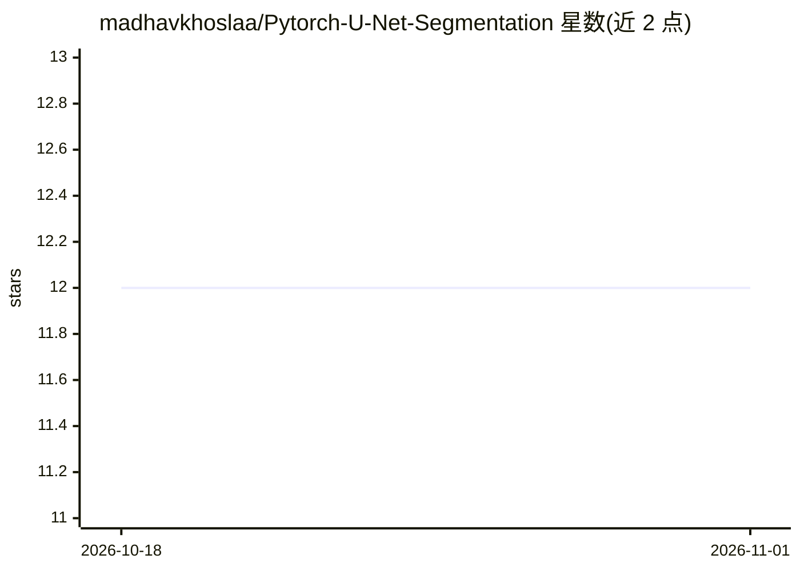

# madhavkhoslaa/Pytorch-U-Net-Segmentation

⭐ 12 · Jupyter Notebook · GPL-3.0 · 推送 2026-02-03 · [GitHub](https://github.com/madhavkhoslaa/Pytorch-U-Net-Segmentation) · [官网](https://arxiv.org/abs/1505.04597) · 个人维护

**U-Net 语义分割的 PyTorch 实现，含 one-hot 编码工具**

U-Net 论文的 PyTorch 实现仓库，用于图像语义分割训练。提供脚本下载 Inria 航拍影像标注数据集（5k 张图，README 提示家用电脑算力受限）；内置 HotEncoder 工具，可将 n 类标注编码为 n×高×宽 的 one-hot 矩阵，也可单独用于逐像素类别矩阵生成与通道拆分。使用方式：git clone 后在 config.json 填入数据路径与图像分辨率，修改 train.py 中的文件扩展名后运行训练，生成 .pth 模型文件。已知限制：单通道 tif 标注无法编码、predict.py 未测试。

## 筛选速览

| 维度 | 判定 | 备注 |
|---|---|---|
| AI 角色 | `ai-native` | 本体是模型或模型工具 |
| 许可风险 | `viral` | GPL-3.0 |
| 部署形态 | `None` |  |
| 模型依赖 | — | README 未给出锁定关系 |
| 硬件要求 | — | 无带数字的原话,不猜 |
| 安装摩擦 | `low` | 无编译、无系统依赖或容器化 |
| 成熟度 | — | 结构信号不足 |

## 能力要点

- U-Net 模型的 PyTorch 训练实现，保存 .pth 模型文件
- HotEncoder 将 n 类标注编码为 n×高×宽 one-hot 矩阵
- 脚本下载 Inria 航拍影像标注数据集
- 编码器可独立使用（逐像素类别矩阵、通道拆分）

## 适用场景

- 在自备数据集上训练 U-Net 做语义分割
- 将彩色标注图转换为 one-hot 编码矩阵用于训练
- 复现 U-Net 论文在航拍影像上的分割流程

## 场景标签

`目标检测` · 领域:感知与多模态

## 证据(README 行号)

> L1: ## This repository is an implementation on the U-Net Paper.
> L5: * To use train it, put the Images and the gt file locations in the config.json folder and execute train.py, a .pth f

## 星数曲线

2026-10-18 12 → 2026-11-01 12（+0）

---
*卡片 v1 · prompt 1.4 · 生成 2026-11-01 · 置信度 high · 依据 README sha `df1f6c7cbe65` · [字段定义](../../DATASET.md)*
