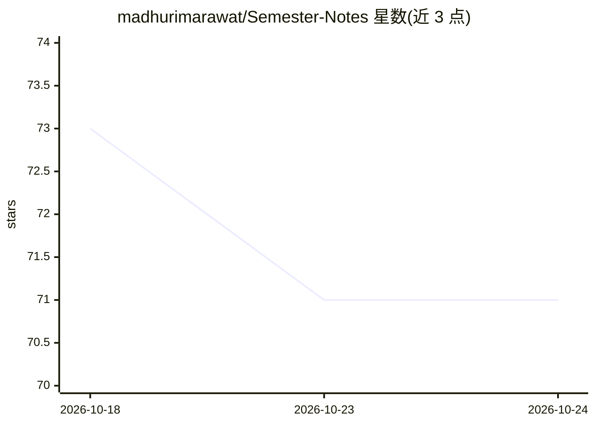

# madhurimarawat/Semester-Notes

⭐ 71 · HTML · MIT · 推送 2026-04-25 · [GitHub](https://github.com/madhurimarawat/Semester-Notes) · [官网](https://madhurimarawat.github.io/Semester-Notes/) · 个人维护

**B.Tech CSE（AI/DS 方向）八年学期课程笔记与试卷知识库**

个人维护的 B.Tech (Hons) CSE 学习资源仓库，按 1-8 学期组织课程笔记、实验程序、试卷与教学大纲，覆盖人工智能与数据科学方向课程（如 NLP、模式识别与机器学习、人工神经网络、深度学习等）。内容以文档形式提供，并配套一个静态网站（GitHub Pages）：含学科导航、季节主题切换、Dark Mode、以及 Git/Hadoop/Astyle 命令参考。第 1-4 学期两方向共用课程，5-8 学期按 AI/DS 分化并分别提供试卷与大纲。

## 筛选速览

| 维度 | 判定 | 备注 |
|---|---|---|
| AI 角色 | `ai-knowledge` | 知识聚合/清单类 |
| 许可风险 | `permissive` | MIT |
| 部署形态 | `None` |  |
| 模型依赖 | — | README 未给出锁定关系 |
| 硬件要求 | — | 无带数字的原话,不猜 |
| 安装摩擦 | `low` | 无编译、无系统依赖或容器化 |
| 成熟度 | — | 结构信号不足 |

## 能力要点

- 1-8 学期分科目组织的课程笔记与实验程序索引
- 分类学期试卷（含 Class Test 与 Annual）及教学大纲
- 配套静态网站：学科导航、季节主题、Dark Mode、命令参考

## 适用场景

- 按学期复习 CSE/AI/DS 课程并快速定位笔记
- 查找往年试卷与教学大纲进行备考
- 获取 Git、Hadoop、Astyle 等工具的命令参考

## 场景标签

`教程课程` · 领域:学习与行业

## 证据(README 行号)

> L1: # Semester-Notes
> L2: A comprehensive, well-structured repository of B.Tech (Hons) CSE notes and learning resources, specializing in Artif

## 星数曲线

2026-10-18 73 → 2026-10-24 71（-2）

---
*卡片 v1 · prompt 1.4 · 生成 2026-10-24 · 置信度 high · 依据 README sha `640935a5e51d` · [字段定义](../../DATASET.md)*
