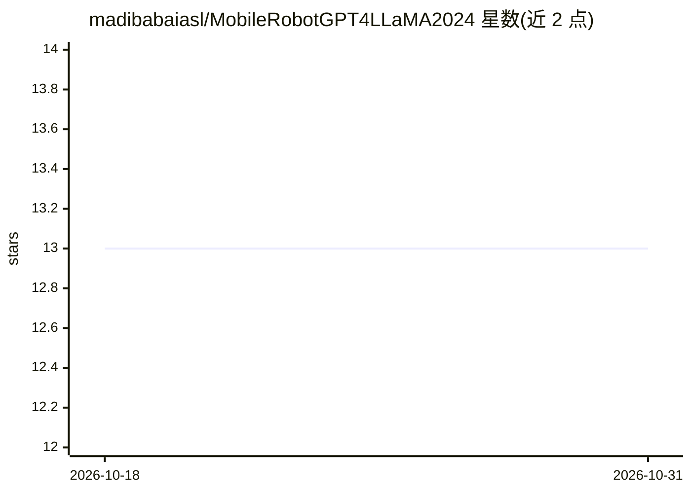

# madibabaiasl/MobileRobotGPT4LLaMA2024

⭐ 13 · Python · NOASSERTION · 推送 2026-07-12 · [GitHub](https://github.com/madibabaiasl/MobileRobotGPT4LLaMA2024) · 组织维护

**在边缘设备部署 LLM 控制移动小车的科研代码**

论文配套研究实现：通过语音输入（离线 VOSK 转写）或文本，调用 LLM（GPT-3.5 API 或 llama.cpp 量化的 Llama-2-7B-Chat）生成控制命令，经正则解析后发送至 ELEGOO 智能小车，实现边缘端的自然语言机器人控制。提供 OpenAI 在线与离线量化两条路径，含硬件搭建指引、模型下载与配置步骤及演示视频。在 Ubuntu 22.04 / Python 3.10 开发测试。

## 筛选速览

| 维度 | 判定 | 备注 |
|---|---|---|
| AI 角色 | `ai-native` | 本体是模型或模型工具 |
| 许可风险 | `none` | NOASSERTION |
| 部署形态 | `None` |  |
| 模型依赖 | local-ok | 支持本地模型 |
| 硬件要求 | — | 无带数字的原话,不猜 |
| 安装摩擦 | `low` | 无编译、无系统依赖或容器化 |
| 成熟度 | — | 结构信号不足 |

## 能力要点

- 双路径 LLM：OpenAI API（GPT-3.5）与 llama.cpp 量化 Llama-2-7B
- VOSK 离线语音转文本作为输入通道
- 正则解析器从 LLM 输出中抽取有效控制命令
- 配套 ELEGOO 智能小车硬件搭建教程与演示视频

## 适用场景

- 复现边缘端 LLM 机器人控制实验
- 用自然语言或语音指挥智能小车移动
- 对比在线 API 与本地量化模型的边缘部署方案

## 场景标签

`科研工具` · 领域:学习与行业

## 证据(README 行号)

> L1: ## Deployment of Large Language Models to Control Mobile Robots at the Edge
> L10: LLM Implementation: llama.cpp (llama-2-7b-chatQ5_K_S)
> L30: The offline LLM model will sometimes output a command along with some words or sentences. We can use a Regex parser

## 星数曲线

2026-10-18 13 → 2026-10-31 13（+0）

---
*卡片 v1 · prompt 1.4 · 生成 2026-10-31 · 置信度 high · 依据 README sha `2d481d318d5b` · [字段定义](../../DATASET.md)*
