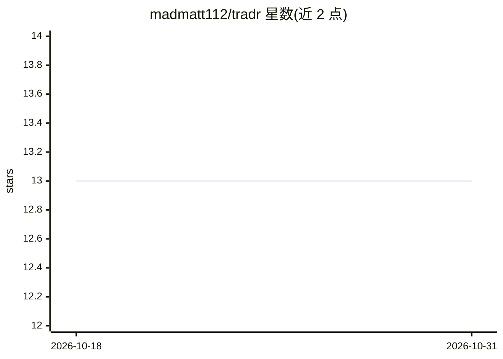

# madmatt112/tradr

⭐ 13 · TypeScript · Apache-2.0 · 推送 2026-10-30 · [GitHub](https://github.com/madmatt112/tradr) · [官网](https://www.tradr.cloud) · 个人维护

**面向期权与股票交易者的自托管交易日志与分析平台**

Tradr 是可自托管的交易日志与分析平台，面向期权和股票交易者：记录仓位全流程（草稿、加仓、分批平仓）及每笔成交、费用与笔记，提供多券商多币种账户账本与对账、净值曲线绩效分析、期权链查询、OCC 符号解析与 Black-Scholes 定价及希腊值、交易计算器和 CSV 导入。通过 Docker Compose 一条快速脚本自部署，所有外部集成为可选，不下单。Pre-1.0，HTTP API 尚未稳定。另有托管版（免费版有上限，Pro $10/月）。

## 筛选速览

| 维度 | 判定 | 备注 |
|---|---|---|
| AI 角色 | `ai-enhanced` | 去掉 AI 部分产品仍成立 |
| 许可风险 | `permissive` | Apache-2.0 |
| 部署形态 | `None` |  |
| 模型依赖 | — | README 未给出锁定关系 |
| 硬件要求 | — | 无带数字的原话,不猜 |
| 安装摩擦 | `low` | 无编译、无系统依赖或容器化 |
| 成熟度 | `idea` | |

## 能力要点

- 仓位级日志：多次成交汇总为一个仓位，含均价与扣费后已实现盈亏
- 期权工具：链查询、OCC 符号解析、Black-Scholes 定价与全部希腊值
- 多券商多币种账户账本与对账、净值曲线绩效分析
- Docker Compose 快速启动脚本自托管，外部集成全部 opt-in

## 适用场景

- 记录并复盘期权和股票交易的每笔成交与费用
- 进场前用计算器算仓位规模、风险回报比与预估费用
- 把多年券商历史记录通过 CSV 导入并统一分析

## 场景标签

`金融量化` · 领域:学习与行业

## 证据(README 行号)

> L12: Tradr is a self-hostable journal for options and equities traders. It records the whole
> L80: - **Options tools** — chain lookup, OCC symbol parsing, Black-Scholes pricing with full Greeks.

## 星数曲线

2026-10-18 13 → 2026-10-31 13（+0）

---
*卡片 v1 · prompt 1.4 · 生成 2026-10-31 · 置信度 mid · 依据 README sha `67b765119298` · [字段定义](../../DATASET.md)*
