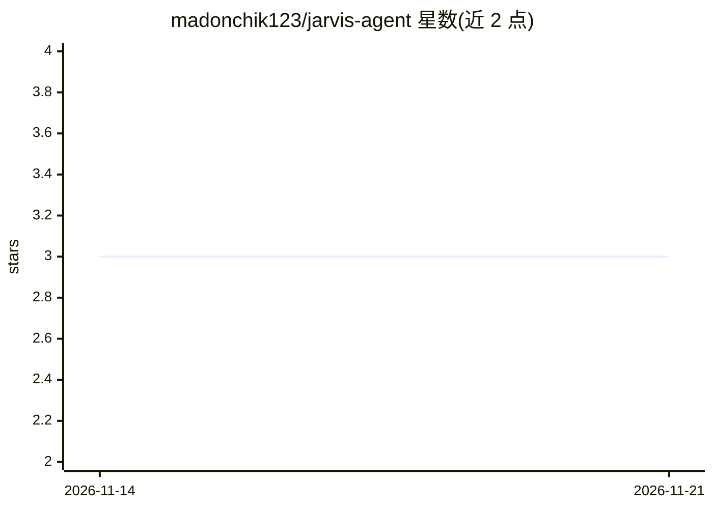

# madonchik123/jarvis-agent

⭐ 3 · TypeScript · MIT · 推送 2026-10-24 · [GitHub](https://github.com/madonchik123/jarvis-agent) · 个人维护

**面向 Windows 用户的开源语音 AI 助手，语音控制电脑操作**

基于 Electron 的 Windows 桌面语音助手：持续唤醒词监听，本地 RU/EN 语音识别（GigaAM/Parakeet/Whisper），通过 opencode 代理执行 shell、文件、网络与 MCP 工具（Gmail、日历、Notion、GitHub 等），并借助 C# 原生引擎以 UI Automation、OCR 与 SendInput 控制任意 Windows 应用。语音输出支持免费服务器、Fish Audio、Piper 或 XTTS-v2。需 Windows 10/11 x64 与麦克风，约 1 GB 内存与磁盘空间；语音识别模型首次启动自动下载。MIT 许可，无遥测。

## 筛选速览

| 维度 | 判定 | 备注 |
|---|---|---|
| AI 角色 | `ai-native` | 本体是模型或模型工具 |
| 许可风险 | `permissive` | MIT |
| 部署形态 | `desktop` | 安装包/桌面程序 |
| 模型依赖 | local-ok | 支持本地模型 |
| 硬件要求 | — | 无带数字的原话,不猜 |
| 安装摩擦 | `low` | 无编译、无系统依赖或容器化 |
| 成熟度 | — | 结构信号不足 |

## 能力要点

- 本地语音识别：俄语 GigaAM v3、英语 Parakeet-TDT/Whisper
- C# 原生引擎通过 UI Automation 与 OCR 控制 Windows 应用
- MCP 连接器目录：Gmail、日历、Notion、GitHub、Playwright 等
- 支持 230+ 模型提供商（经 opencode），默认免费模型免 key

## 适用场景

- 用语音唤醒助手完成打开应用、操作界面、系统设置等任务
- 语音读邮件、管理日历与 Notion（经 MCP 连接器）
- 生成/编辑 DOCX、PPTX、PDF 文档并朗读结果
- 设置免模型的自定义语音命令序列

## 场景标签

`语音 Agent` `GUI 自动化` `AI 助手` · 领域:效率与自动化

## 证据(README 行号)

> L5: Настольный ассистент в духе Джарвиса из фильмов Marvel. Скажите **«Джарвис»** / **"Jarvis"** — и он слушает, думает 
> L6: **агента** (opencode), отвечает голосом Джарвиса, **видит ваш экран и управляет любым приложением Windows**
> L51: |**Настоящий агент с характером**|opencode с собственным агентом `jarvis`: shell, файлы, интернет, MCP-инструменты,

## 星数曲线

2026-11-14 3 → 2026-11-21 3（+0）

---
*卡片 v1 · prompt 1.4 · 生成 2026-11-21 · 置信度 high · 依据 README sha `0bb5c2604025` · [字段定义](../../DATASET.md)*
