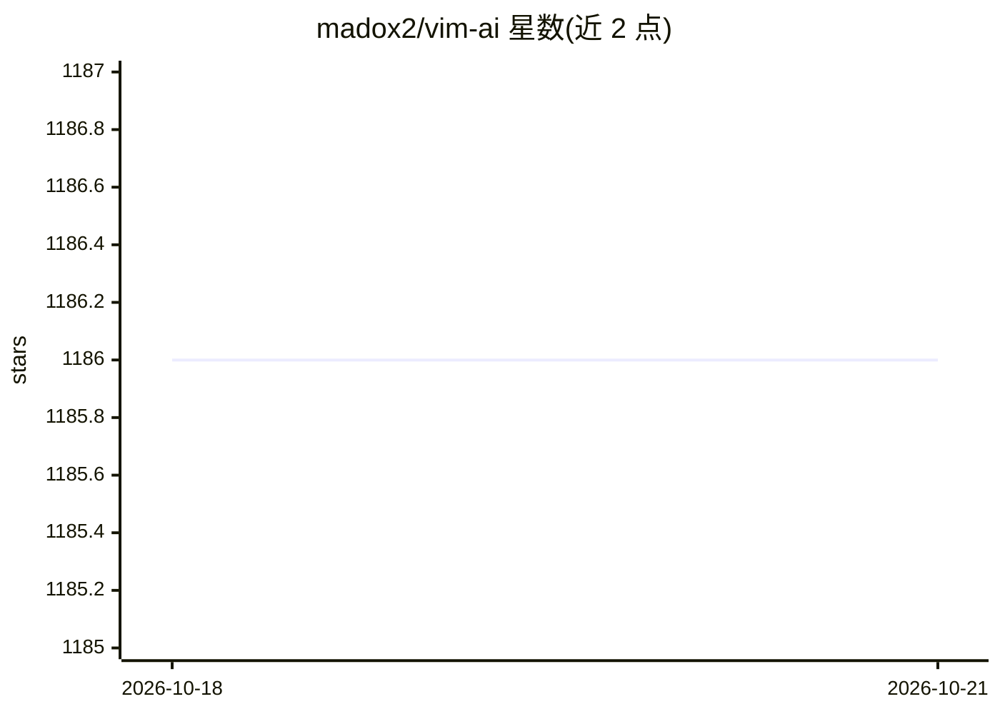

# madox2/vim-ai

⭐ 1,186 · Python · MIT · 推送 2026-10-14 · [GitHub](https://github.com/madox2/vim-ai) · 个人维护

**Vim/Neovim 的 AI 代码助手插件：补全、编辑、对话、生图**

为 Vim 和 Neovim 添加 AI 能力的插件，通过 OpenAI API 提供文本/代码补全（:AI）、就地编辑选区（:AIEdit）、交互式对话（:AIChat）、图像生成（:AIImage）与视觉图像转文字功能。支持自定义角色（.ini 配置）、.aichat 可复用提示文件（含 include/exec 段），可配置任意 OpenAI 兼容端点（如 OpenRouter、本地代理 LiteLLM），并可通过第三方 provider 插件接入 Gemini 等模型。要求 Vim/Neovim 带 python3 支持和 API key，需按 token 付费；声明生成内容可能出错，且会把文本发送给 API 提供方。

## 筛选速览

| 维度 | 判定 | 备注 |
|---|---|---|
| AI 角色 | `ai-native` | 本体是模型或模型工具 |
| 许可风险 | `permissive` | MIT |
| 部署形态 | `None` |  |
| 模型依赖 | — | README 未给出锁定关系 |
| 硬件要求 | — | 无带数字的原话,不猜 |
| 安装摩擦 | `low` | 无编译、无系统依赖或容器化 |
| 成熟度 | — | 结构信号不足 |

## 能力要点

- :AI/:AIEdit/:AIChat/:AIImage 命令覆盖补全、编辑、对话与生图
- 可配置任意 OpenAI 兼容端点与自定义角色（roles.ini）
- .aichat 文件支持 include 文件、exec 命令输出与图像视觉输入
- 可通过 provider 插件扩展接入 Gemini 等其他模型

## 适用场景

- 在编辑器内对选中文本做 AI 补全或就地改写
- 与 GPT 模型进行可保存、可恢复的多轮对话
- 通过 OpenRouter 等代理使用 Gemini/Claude 等其他模型

## 场景标签

`代码生成` `图像生成` `聊天机器人` · 领域:编码与开发

## 证据(README 行号)

> L3: This plugin adds Artificial Intelligence (AI) capabilities to your Vim and Neovim.
> L4: You can generate code, edit text, or have an interactive conversation with GPT models, all powered by OpenAI's API.
> L12: - Generate text or code, answer questions with AI

## 星数曲线

2026-10-18 1,186 → 2026-10-21 1,186（+0）

---
*卡片 v1 · prompt 1.4 · 生成 2026-10-21 · 置信度 high · 依据 README sha `fd1cb3fc28a0` · [字段定义](../../DATASET.md)*
