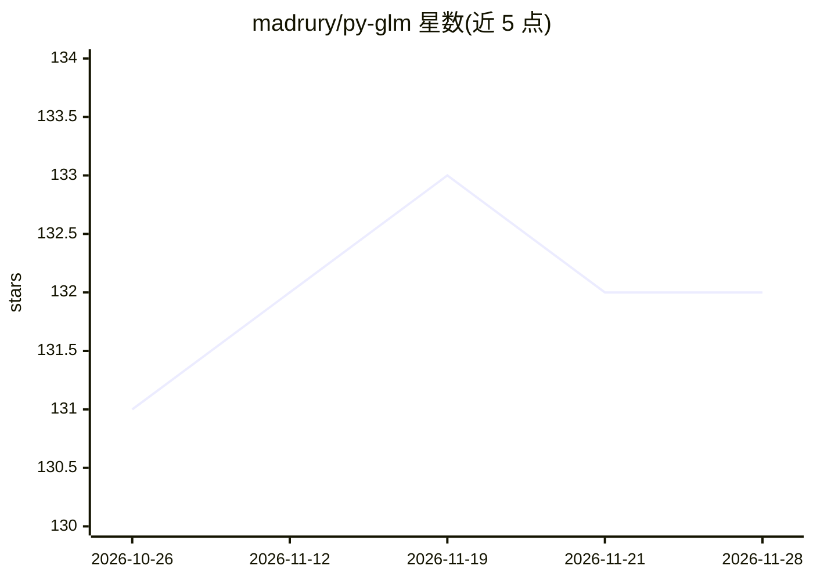

# madrury/py-glm

⭐ 132 · Python · BSD-3-Clause · 推送 2026-11-27 · [GitHub](https://github.com/madrury/py-glm) · 个人维护

**给 Python 用户提供广义线性模型的拟合与推断库**

以 Fisher scoring 拟合广义线性模型的 Python 库，支持 R 风格模型公式（由 formulaic 提供变换语言）、offset、频率权重与精度权重、线性约束假设检验、ridge 正则化和参数/非参数 bootstrap。提供 sklearn 风格的 fit/predict 接口，predict 统一返回条件期望而非类别标签。要求 Python 3.13+，从 GitHub 以 pip 安装，绘图功能需 matplotlib 可选 extra；缺失值不自动处理，需用户先行清理。

## 筛选速览

| 维度 | 判定 | 备注 |
|---|---|---|
| AI 角色 | `ai-native` | 本体是模型或模型工具 |
| 许可风险 | `permissive` | BSD-3-Clause |
| 部署形态 | `library` | 以包/库形式分发 |
| 模型依赖 | — | README 未给出锁定关系 |
| 硬件要求 | — | 无带数字的原话,不猜 |
| 安装摩擦 | `low` | 无编译、无系统依赖或容器化 |
| 成熟度 | — | 结构信号不足 |

## 能力要点

- Fisher scoring 拟合多种指数族模型（含带离散参数的 QuasiPoisson/Gamma）
- R 风格模型公式：分类变量、三次样条与有状态变换
- 系数推断、Wald 检验（约束方程/嵌套模型/约束数组）与 summary_frame 输出
- 参数与非参数 bootstrap，响应模拟模块

## 适用场景

- 对保险理赔等暴露数据拟合 Poisson/Gamma 回归模型
- 对回归系数做假设检验与置信区间推断
- 用 bootstrap 评估模型系数的稳定性

## 场景标签

 · 领域:统计学习/回归分析

## 证据(README 行号)

> L3: `py-glm` is a library for fitting, inspecting, and simulating from generalized
> L5: model formulas, offsets, frequency and precision weights, hypothesis tests on

## 星数曲线

2026-10-26 131 → 2026-11-28 132（+1）

---
*卡片 v1 · prompt 1.4 · 生成 2026-11-28 · 置信度 high · 依据 README sha `80bfd0c32dcf` · [字段定义](../../DATASET.md)*
