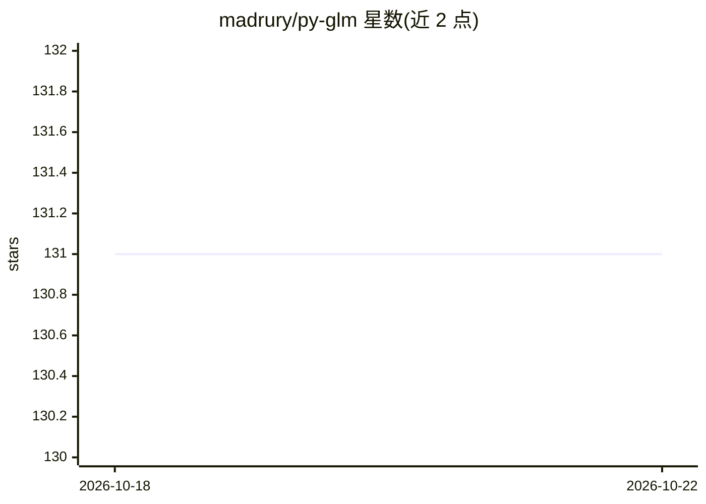

# madrury/py-glm

⭐ 131 · Python · BSD-3-Clause · 推送 2026-10-09 · [GitHub](https://github.com/madrury/py-glm) · 个人维护

**Python 广义线性模型库：sklearn 风格拟合、推断与模拟**

Python 库，提供广义线性模型的拟合、推断与模拟：Fisher scoring 算法拟合，支持多种指数族分布（Gaussian/Bernoulli/Poisson/Gamma/QuasiPoisson 等）、模型公式（formulaic 语法）、offset、样本权重、ridge 正则化及参数/非参数 bootstrap。面向统计分析与机器学习开发者，接口遵循 sklearn 风格但 predict 一律返回条件期望 E[y|X]。要求 Python 3.13+，从 GitHub 安装；设计矩阵首列须为截距列，缺失值需用户自行处理。

## 筛选速览

| 维度 | 判定 | 备注 |
|---|---|---|
| AI 角色 | `ai-native` | 本体是模型或模型工具 |
| 许可风险 | `permissive` | BSD-3-Clause |
| 部署形态 | `library` | 以包/库形式分发 |
| 模型依赖 | — | README 未给出锁定关系 |
| 硬件要求 | — | 无带数字的原话,不猜 |
| 安装摩擦 | `low` | 无编译、无系统依赖或容器化 |
| 成熟度 | `idea` | |

## 能力要点

- Fisher scoring 拟合，支持多指数族与离散参数模型
- 模型公式（formulaic 语法）自动编码训练时的类别与变换
- 参数/非参数 bootstrap 与系数表、z 检验 p 值
- 全量类型标注（mypy --strict）并附带 py.typed 标记

## 适用场景

- 用 Poisson/Logistic 等 GLM 做回归分析与统计推断
- 通过 bootstrap 估计稳健标准误与置信区间
- 带 ridge 正则化的广义线性模型拟合

## 场景标签

`数据分析` · 领域:效率与自动化

## 证据(README 行号)

> L3: `py-glm` is a library for fitting, inspecting, and simulating from generalized
> L4: linear models in Python. Models are fit with Fisher scoring, and support model

## 星数曲线

2026-10-18 131 → 2026-10-22 131（+0）

---
*卡片 v1 · prompt 1.4 · 生成 2026-10-22 · 置信度 mid · 依据 README sha `9f9d34067275` · [字段定义](../../DATASET.md)*
