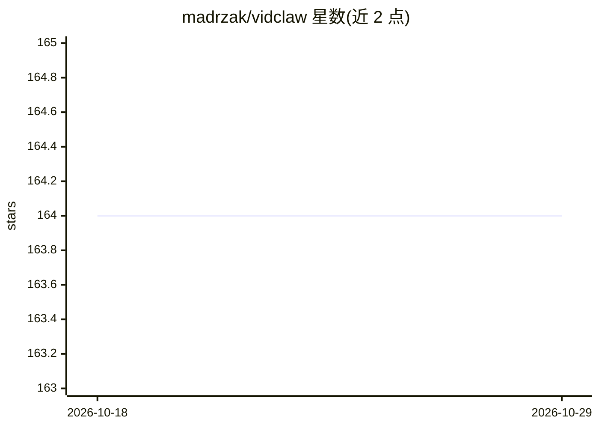

# madrzak/vidclaw

⭐ 164 · TypeScript · 推送 2026-03-18 · [GitHub](https://github.com/madrzak/vidclaw) · [官网](http://vidclaw.com) · 个人维护

**自托管的 OpenClaw AI agent 管理面板**

面向 OpenClaw AI agent 用户的暗色主题自托管管理面板：提供 Kanban 任务看板（拖拽排序、优先级、技能分配，agent 通过 heartbeat 或 cron 自动领取执行）、从会话记录解析的 token 用量与成本追踪、Claude 模型切换、活动日历、工作区文件浏览、技能管理器与 SOUL.md 等人格文件编辑。仅绑定 localhost，远程访问经 Tailscale Serve 或 SSH 隧道。需预装 OpenClaw 与 Node.js>=18。

## 筛选速览

| 维度 | 判定 | 备注 |
|---|---|---|
| AI 角色 | `ai-ecosystem` | LLM/agent 周边工具 |
| 许可风险 | `none` | — |
| 部署形态 | `None` |  |
| 模型依赖 | — | README 未给出锁定关系 |
| 硬件要求 | — | 无带数字的原话,不猜 |
| 安装摩擦 | `low` | 无编译、无系统依赖或容器化 |
| 成熟度 | — | 结构信号不足 |

## 能力要点

- Kanban 看板任务由 agent 经 cron/heartbeat 自动执行
- 从会话记录解析 token 用量与成本估算
- 看板内直接切换 Claude 模型并热重载
- 技能管理器与人格文件（SOUL.md 等）编辑含版本历史

## 适用场景

- 给运行的 OpenClaw agent 分派和跟踪任务
- 监控 agent 的 token 消耗与成本
- 编辑 agent 的人格与技能配置

## 场景标签

`LLM 可观测性` · 领域:评测与运维

## 证据(README 行号)

> L3: A secure, self-hosted command center for managing your OpenClaw AI agent.
> L9: - **🗂️ Kanban Task Board** — Backlog → Todo → In Progress → Done. Drag & drop, priorities, skill assignment. Your ag

## 星数曲线

2026-10-18 164 → 2026-10-29 164（+0）

---
*卡片 v1 · prompt 1.4 · 生成 2026-10-22 · 置信度 high · 依据 README sha `6192e104242a` · [字段定义](../../DATASET.md)*
