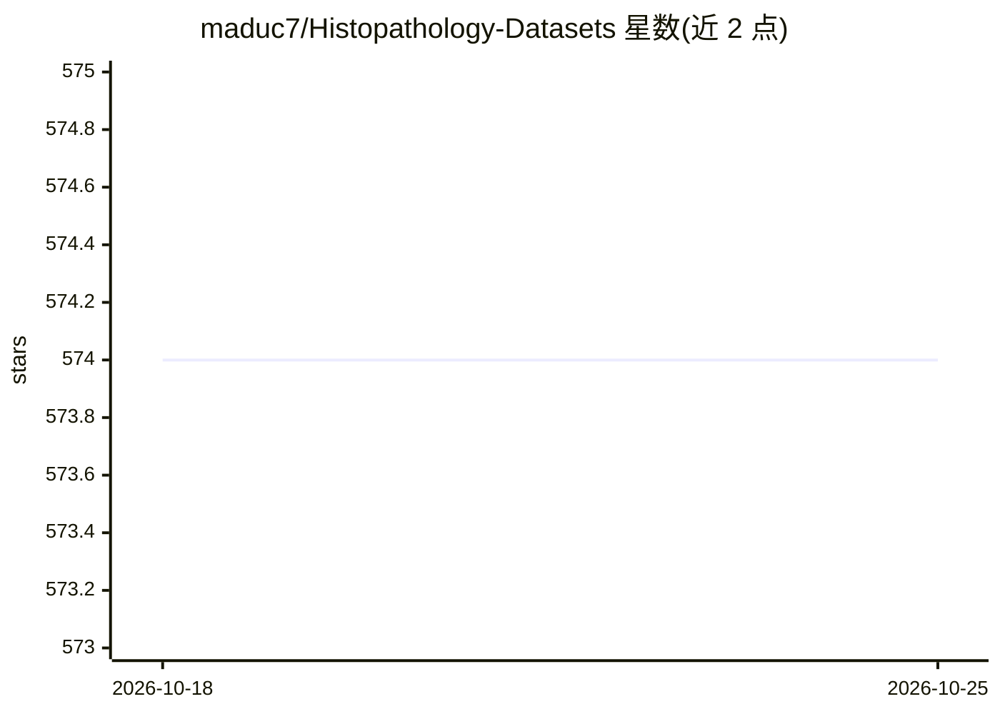

# maduc7/Histopathology-Datasets

⭐ 574 · 推送 2026-03-06 · [GitHub](https://github.com/maduc7/Histopathology-Datasets) · 个人维护

**公开组织病理学数据集清单，供分类/分割/配准任务检索**

面向机器学习研究者的组织病理学（histopathology）公开数据集聚合清单：以表格形式逐条列出数据集的器官、染色方法、数据/论文链接、训练/测试规模、标注类型、任务类型（分类/分割/回归/配准）、WSI 或 patch 形式、扫描仪与放大倍数、年份等字段，覆盖乳腺、肺、结肠、前列腺、血液等多种器官与组织，供研究者按需检索数据来源。清单开放社区协作更新。

## 筛选速览

| 维度 | 判定 | 备注 |
|---|---|---|
| AI 角色 | `ai-knowledge` | 知识聚合/清单类 |
| 许可风险 | `none` | — |
| 部署形态 | `None` |  |
| 模型依赖 | — | README 未给出锁定关系 |
| 硬件要求 | — | 无带数字的原话,不猜 |
| 安装摩擦 | `low` | 无编译、无系统依赖或容器化 |
| 成熟度 | — | 结构信号不足 |

## 能力要点

- 以表格组织数据集元信息：器官、染色、规模、任务、扫描仪、年份
- 覆盖分类、分割、回归、配准等多类任务
- 多数条目同时给出数据链接与论文链接
- 开放社区协作更新与扩充

## 适用场景

- 为组织病理学图像的模型训练寻找公开数据集
- 按器官、染色或任务类型筛选可用数据来源
- 调研领域内公开数据集的规模与标注情况

## 场景标签

`精选清单` · 领域:学习与行业

## 证据(README 行号)

> L1: # `Histopathology Datasets for Machine Learning`
> L3: This is a list of histopathology datasets made public for classification, segmentation, regression and/or registrati

## 星数曲线

2026-10-18 574 → 2026-10-25 574（+0）

---
*卡片 v1 · prompt 1.4 · 生成 2026-10-21 · 置信度 high · 依据 README sha `62bd56a8944e` · [字段定义](../../DATASET.md)*
