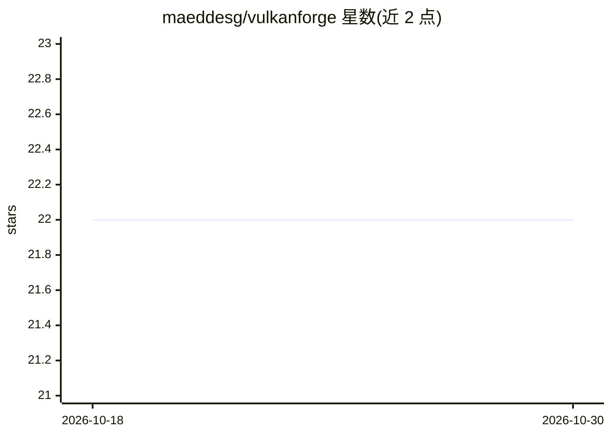

# maeddesg/vulkanforge

⭐ 22 · Rust · GPL-3.0 · 推送 2026-06-20 · [GitHub](https://github.com/maeddesg/vulkanforge) · 个人维护

**面向 AMD RDNA4 GPU 的 Rust+Vulkan LLM 推理引擎，支持 GGUF 与原生 FP8**

纯 Rust 实现的本地 LLM 推理引擎，通过 Vulkan compute shader 在 AMD RDNA4 消费级 GPU 上运行推理，编译为约 14 MB 静态二进制，运行时仅需系统 Vulkan loader。支持 GGUF 与 HuggingFace SafeTensors 原生 FP8 E4M3 加载（三种 FP8 缩放策略自动检测），在 Mesa 26.1+ 上自动启用原生 FP8 WMMA；覆盖 Llama-3、Qwen2.5/3、Mistral、DeepSeek-R1-Distill、Gemma-4 等模型族。附带 serve 服务、聊天 CLI 与 agentic 客户端 vf-clide，可选启用项目级语义记忆层。基于 oldnordic 的 ROCmForge 基础工作构建。

## 筛选速览

| 维度 | 判定 | 备注 |
|---|---|---|
| AI 角色 | `ai-ecosystem` | LLM/agent 周边工具 |
| 许可风险 | `viral` | GPL-3.0 |
| 部署形态 | `None` |  |
| 模型依赖 | — | README 未给出锁定关系 |
| 硬件要求 | `gpu-24g` | |
| 安装摩擦 | `medium` | 含编译或系统依赖之一 |
| 成熟度 | — | 结构信号不足 |

## 能力要点

- GGUF 与 SafeTensors 原生 FP8 E4M3 直读，磁盘上无 FP16 往返
- Mesa 26.1+ 上原生 FP8 WMMA（shaderFloat8CooperativeMatrix），FP8 prefill +45–58%
- CPU lm_head 卸载（Q6_K + AVX-512），14B FP8 下快于 GPU 基线
- vf-clide 客户端：流式 REPL、三级权限模型、workspace 限制、工具调用

## 适用场景

- 在 AMD RDNA4 显卡上本地运行 Qwen/Llama/Gemma 等 GGUF 或 FP8 模型
- 通过 serve 提供 OpenAI 风格 API 并管理 KV 上下文
- 用 vf-clide 在受限权限下做 agentic 编码任务

## 场景标签

`推理引擎` · 领域:训练与推理

## 证据(README 行号)

> L3: LLM inference engine for AMD RDNA4 GPUs. Pure Rust + Vulkan compute
> L122: - **Native FP8 E4M3** loader that ingests HuggingFace SafeTensors
> L126: - **Native FP8 WMMA on Mesa 26.1+** (auto-enabled when the driver

## 星数曲线

2026-10-18 22 → 2026-10-30 22（+0）

---
*卡片 v1 · prompt 1.4 · 生成 2026-10-27 · 置信度 high · 依据 README sha `ba5825a76c2c` · [字段定义](../../DATASET.md)*
