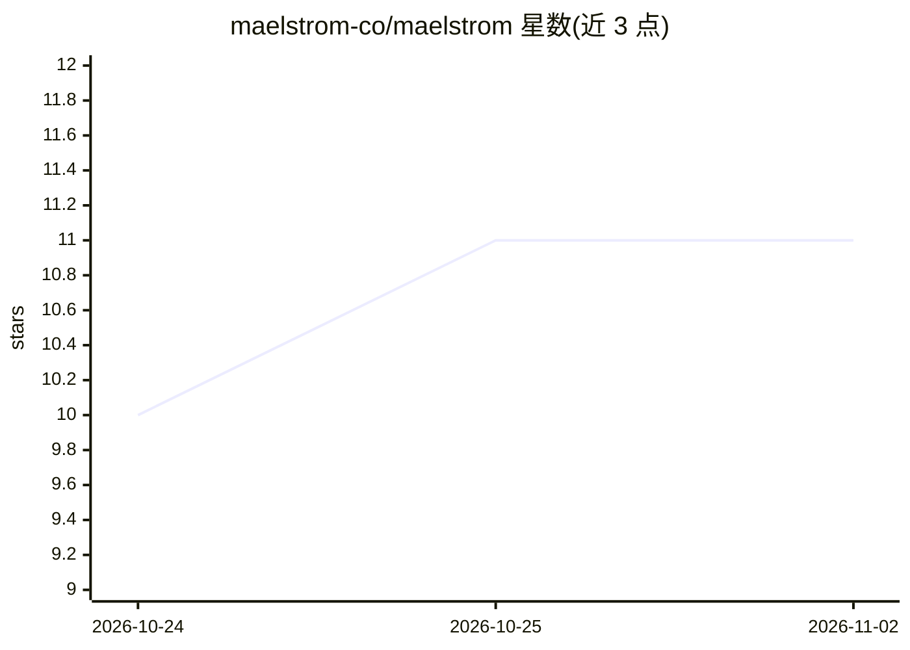

# maelstrom-co/maelstrom

⭐ 11 · TypeScript · MIT · 推送 2026-11-01 · [GitHub](https://github.com/maelstrom-co/maelstrom) · [官网](https://maelstrom-ai.co) · 组织维护

**AI 编排 UI 框架：让模型实时编排你预构建的组件**

开源 TypeScript/React 库：开发者将组件封装为 Vessels（带离散变体与尺寸提示的类型化状态机），LLM 引擎根据用户意图在空间布局面（tiling 分割树或整数网格模式）上编排、缩放、切换组件并调用其声明的动作，但不生成组件内容。引擎不持有布局状态，按请求返回布局与动作；对话历史与语音均为可选。由 maelstrom_co 团队维护，MIT 许可，提供 React starter 与 BYOK 在线演示。

## 筛选速览

| 维度 | 判定 | 备注 |
|---|---|---|
| AI 角色 | `ai-ecosystem` | LLM/agent 周边工具 |
| 许可风险 | `permissive` | MIT |
| 部署形态 | `None` |  |
| 模型依赖 | — | README 未给出锁定关系 |
| 硬件要求 | — | 无带数字的原话,不猜 |
| 安装摩擦 | `low` | 无编译、无系统依赖或容器化 |
| 成熟度 | — | 结构信号不足 |

## 能力要点

- Vessel 类型化状态机组件 + 模型仅编排不发明内容
- tiling 分割树与整数网格两种离散布局模式
- 引擎无状态，protocol 包用 zod schema 校验运行时消息
- 语音输入可选（独立发布），意图来源不限形式

## 适用场景

- 构建由模型按用户意图实时调整布局的应用界面
- 在现有 React 应用中接入 AI 编排的组件布局层
- 让语音/文本意图直接驱动界面组件的展示与操作

## 场景标签

`Agent 框架` · 领域:Agent 开发

## 证据(README 行号)

> L13: Maelstrom is an open-source library for **AI-orchestrated UI**. You author your
> L171: Maelstrom's specific focus is **AI-directed spatial layout over your pre-built,

## 星数曲线

2026-10-24 10 → 2026-11-02 11（+1）

---
*卡片 v1 · prompt 1.4 · 生成 2026-11-02 · 置信度 high · 依据 README sha `1aab974c6b2e` · [字段定义](../../DATASET.md)*
