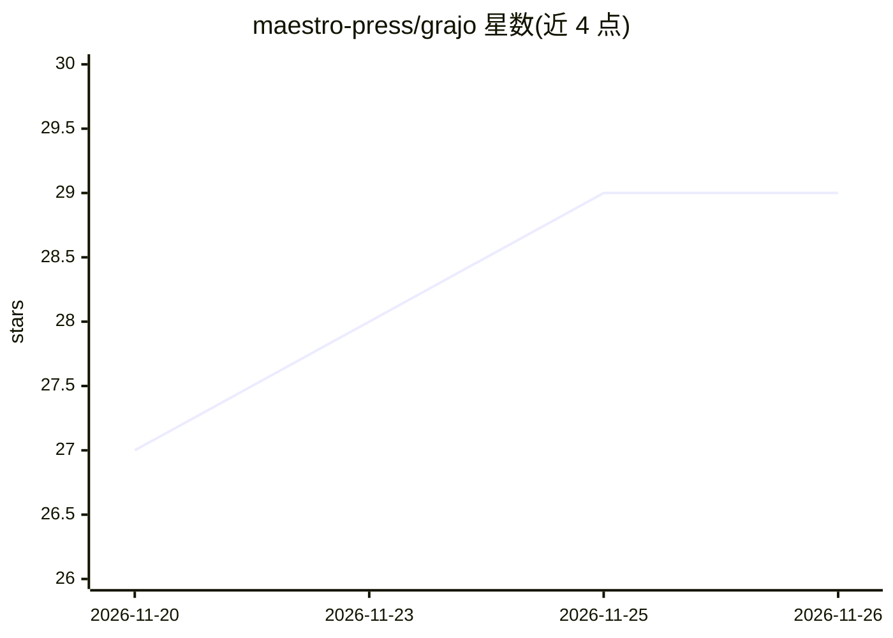

# maestro-press/grajo

⭐ 29 · JavaScript · Apache-2.0 · 推送 2026-11-25 · [GitHub](https://github.com/maestro-press/grajo) · [官网](https://maestro.press/software/crow/) · 组织维护

**自托管的 agentic 框架与 MCP 平台，个人可搭建运行 AI agents**

Crow 是一个自托管的模块化 agentic 框架与 MCP 平台，基于 Model Context Protocol 标准构建。它有两种使用方式：作为 Bot Builder 框架，通过仪表盘配置 persona、技能、工具与权限，将 agent 运行在 email（Gmail）、Discord 与语音（Meta Ray-Ban 眼镜）通道上；作为 MCP 服务器，供 Claude Code、Claude Desktop、Cursor 等客户端原生接入。平台提供持久记忆、项目研究（多格式引用）、端到端加密 P2P 分享、博客、S3 兼容文件存储、20+ 集成网关，以及含 Hugging Face 下载与托管 llama.cpp 运行时的本地模型目录。支持本地或云端模型，数据保存在自有硬件上。

## 筛选速览

| 维度 | 判定 | 备注 |
|---|---|---|
| AI 角色 | `ai-ecosystem` | LLM/agent 周边工具 |
| 许可风险 | `permissive` | Apache-2.0 |
| 部署形态 | `self-host` | docker 或自建部署 |
| 模型依赖 | local-ok | 支持本地模型 |
| 硬件要求 | — | 无带数字的原话,不猜 |
| 安装摩擦 | `low` | 无编译、无系统依赖或容器化 |
| 成熟度 | — | 结构信号不足 |

## 能力要点

- Bot Builder 通过仪表盘配置 agent 的模型、技能、工具与权限策略
- 作为原生 MCP 服务器接入 Claude Code/Claude Desktop/Cursor 等客户端
- 端到端加密 P2P 分享记忆与项目空间，无中心服务器与账户
- 本地模型目录提供 Hugging Face 下载、硬件适配过滤与托管 llama.cpp 运行时

## 适用场景

- 在自有硬件上运行个人 AI agents 并通过 email/Discord/语音交互
- 让已有的 Claude Code 或 Cursor 通过 MCP 访问持久记忆、项目与文件
- 在家庭服务器上搭建本地 AI，数据不出内网
- 在用户之间端到端加密地分享记忆与项目空间

## 场景标签

`Agent 框架` `AI 助手` · 领域:Agent 开发

## 证据(README 行号)

> L5: Crow is a modular, agentic framework and MCP platform that integrates with the services and AI tools you already use
> L11: As an **agentic framework**, build and run your own agents (the Bot Builder) over email, Discord, and voice — local

## 星数曲线

2026-11-20 27 → 2026-11-26 29（+2）

---
*卡片 v1 · prompt 1.4 · 生成 2026-11-20 · 置信度 mid · 依据 README sha `2ffae6c5a9ac` · [字段定义](../../DATASET.md)*
