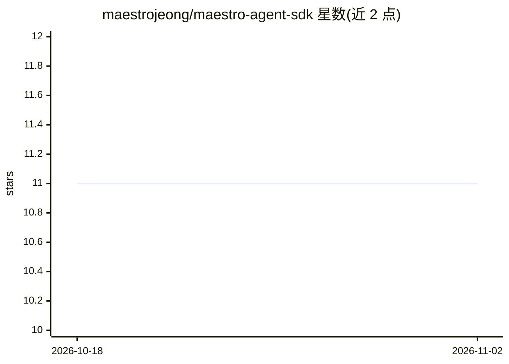

# maestrojeong/maestro-agent-sdk

⭐ 11 · TypeScript · MIT · 推送 2026-10-18 · [GitHub](https://github.com/maestrojeong/maestro-agent-sdk) · 个人维护 · 中文 README

**面向产品嵌入的 TypeScript agent SDK：可插拔提供商与内置工具**

以 ESM 库形式提供的 provider 无关 agent 框架：将 agent 循环（工具调用、流式事件、会话恢复、上下文压缩）作为库调用导入宿主产品，宿主保留 UI、存储、认证与部署控制。支持 DeepSeek、Moonshot Kimi、智谱 GLM 提供商，内置 Bash/Read/Write/Edit/Glob/Grep/WebFetch 工具，支持 MCP（stdio/SSE/Streamable HTTP）、自定义工具、guardrails 与工具钩子；会话以 JSONL 持久化于 ~/.maestro。要求 Node.js 20+，Glob/Grep 依赖 ripgrep（按需安装）。

## 筛选速览

| 维度 | 判定 | 备注 |
|---|---|---|
| AI 角色 | `ai-ecosystem` | LLM/agent 周边工具 |
| 许可风险 | `permissive` | MIT |
| 部署形态 | `library` | 以包/库形式分发 |
| 模型依赖 | locked-api |  |
| 硬件要求 | — | 无带数字的原话,不猜 |
| 安装摩擦 | `low` | 无编译、无系统依赖或容器化 |
| 成熟度 | — | 结构信号不足 |

## 能力要点

- maestroProvider() 一行获得含工具/会话/内存/事件流的完整 agent 循环
- 内置 Bash/Read/Write/Edit/Glob/Grep/WebFetch 工具与 defineTool 自定义工具
- MCP stdio/SSE/Streamable HTTP 客户端支持与延迟工具加载
- llmPreHook/llmPostHook/toolHooks 实现路径白名单、审计与中断等运行时策略

## 适用场景

- 在自己的产品中嵌入带工具调用与流式事件的 agent 能力
- 统一接入 DeepSeek/Kimi/GLM 多家模型提供商
- 通过 MCP 与工具钩子实现受控的工具执行与审计

## 场景标签

`Agent 框架` · 领域:Agent 开发

## 证据(README 行号)

> L9: Import the agent loop into your product, then assemble only what you need:
> L22: - **A harness engine, not a product:** `maestroProvider()` gets you a
> L36: Maestro sits at the library layer. CLI-wrapper SDKs keep another product's

## 星数曲线

2026-10-18 11 → 2026-11-02 11（+0）

---
*卡片 v1 · prompt 1.4 · 生成 2026-11-02 · 置信度 high · 依据 README sha `fb89fe492928` · [字段定义](../../DATASET.md)*
