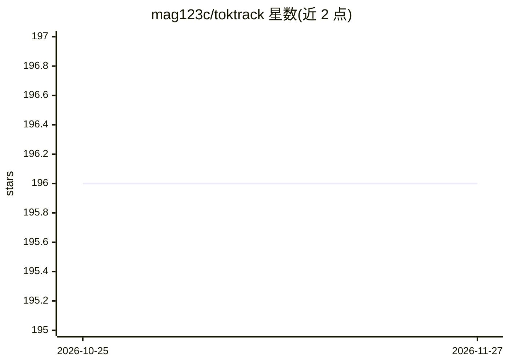

# mag123c/toktrack

⭐ 196 · Rust · MIT · 推送 2026-11-26 · [GitHub](https://github.com/mag123c/toktrack) · [官网](https://www.npmjs.com/package/toktrack) · 个人维护

**聚合多款 AI 编程 CLI 的 token 用量与成本追踪工具**

用 Rust 编写的 CLI 工具，读取本机各 AI 编程 CLI（Claude Code、Codex CLI、Gemini CLI、Copilot CLI 等 9 种）的会话文件，汇总 token 用量与成本，提供 TUI 仪表盘、daily/weekly/monthly 命令、JSON 输出与 SVG 报告。核心机制是持久化缓存：按日汇总写入 ~/.toktrack 缓存且历史日期不可变，使用量记录在源 CLI 删除会话文件后仍可查询；支持 SSH 远程同步 Codex 日志、自定义价格表、shell 提示符显示当日花费。

## 筛选速览

| 维度 | 判定 | 备注 |
|---|---|---|
| AI 角色 | `ai-ecosystem` | LLM/agent 周边工具 |
| 许可风险 | `permissive` | MIT |
| 部署形态 | `library` | 以包/库形式分发 |
| 模型依赖 | — | README 未给出锁定关系 |
| 硬件要求 | — | 无带数字的原话,不猜 |
| 安装摩擦 | `low` | 无编译、无系统依赖或容器化 |
| 成熟度 | — | 结构信号不足 |

## 能力要点

- 读取 9 种 AI 编程 CLI 的会话文件并统一汇总
- 持久化缓存按日冻结，源 CLI 删除会话文件后历史仍可查
- simd-json + rayon 并行解析，缓存查询约 0.04s
- toktrack audit 按来源/日期标注 live / cache-only / missing

## 适用场景

- 统计我在多个 AI 编程 CLI 上的总 token 花费
- Claude Code 30 天自动删除会话后仍想查历史成本
- 按项目维度查看每天、每个模型的用量明细
- 把远程服务器上的 Codex 会话日志同步进来一起统计

## 场景标签

 · 领域:开发者工具/LLM 用量监控

## 证据(README 行号)

> L11: **The token & cost tracker that never loses your history.** Most tools re-read your CLI's session files on every ru
> L13: Track usage across **all your AI coding CLIs** — Claude Code, GitHub Copilot CLI, Codex CLI, Gemini CLI, Qwen Code,

## 星数曲线

2026-10-25 196 → 2026-11-27 196（+0）

---
*卡片 v1 · prompt 1.4 · 生成 2026-11-27 · 置信度 high · 依据 README sha `7aa4c6e2bc19` · [字段定义](../../DATASET.md)*
