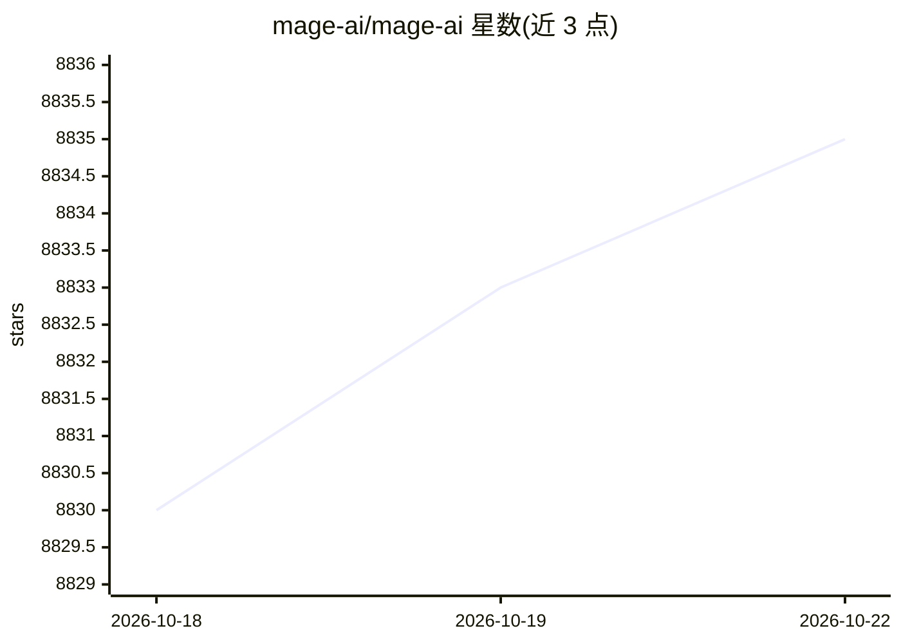

# mage-ai/mage-ai

⭐ 8,835 · Python · Apache-2.0 · 推送 2026-10-16 · [GitHub](https://github.com/mage-ai/mage-ai) · [官网](https://www.mage.ai) · 组织维护

**自托管数据管道开发环境：本地构建、运行与管理 ETL**

面向数据团队的自托管管道开发环境：以 Python、SQL 或 R 在模块化 notebook 式界面中构建管道，支持手动/定时调度、预置连接器对接数据库、API 与云存储，提供可视化调试（日志、数据预览、逐步执行），并可在内部直接运行 dbt 模型。通过 Docker、pip 或 conda 安装，无需云账户。商业版 Mage Pro 另行提供 AI 辅助开发调试、多环境编排与企业功能。

## 筛选速览

| 维度 | 判定 | 备注 |
|---|---|---|
| AI 角色 | `ai-enhanced` | 去掉 AI 部分产品仍成立 |
| 许可风险 | `permissive` | Apache-2.0 |
| 部署形态 | `self-host` | docker 或自建部署 |
| 模型依赖 | — | README 未给出锁定关系 |
| 硬件要求 | — | 无带数字的原话,不猜 |
| 安装摩擦 | `low` | 无编译、无系统依赖或容器化 |
| 成熟度 | — | 结构信号不足 |

## 能力要点

- Python/SQL/R 模块化 notebook 式管道构建
- 预置连接器对接数据库、API 与云存储
- dbt 模型可在 Mage 内构建运行
- Docker/pip/conda 三种安装方式，无需云账户

## 适用场景

- 本地开发并调度 ETL/ELT 管道
- 用可视化 notebook 编写与调试 dbt 模型
- 把数据从 Google Sheets 等来源同步到数据仓库

## 场景标签

`工作流自动化` · 领域:效率与自动化

## 证据(README 行号)

> L5: Mage OSS is a self-hosted development environment designed to help teams create production-grade data pipelines with
> L9: When it’s time to scale, Mage Pro — our core platform — unlocks enterprise orchestration, collaboration, and AI-powe
> L91: - Magical AI-assisted development and debugging

## 星数曲线

2026-10-18 8,830 → 2026-10-22 8,835（+5）

---
*卡片 v1 · prompt 1.4 · 生成 2026-10-20 · 置信度 mid · 依据 README sha `951354a4cf7a` · [字段定义](../../DATASET.md)*
