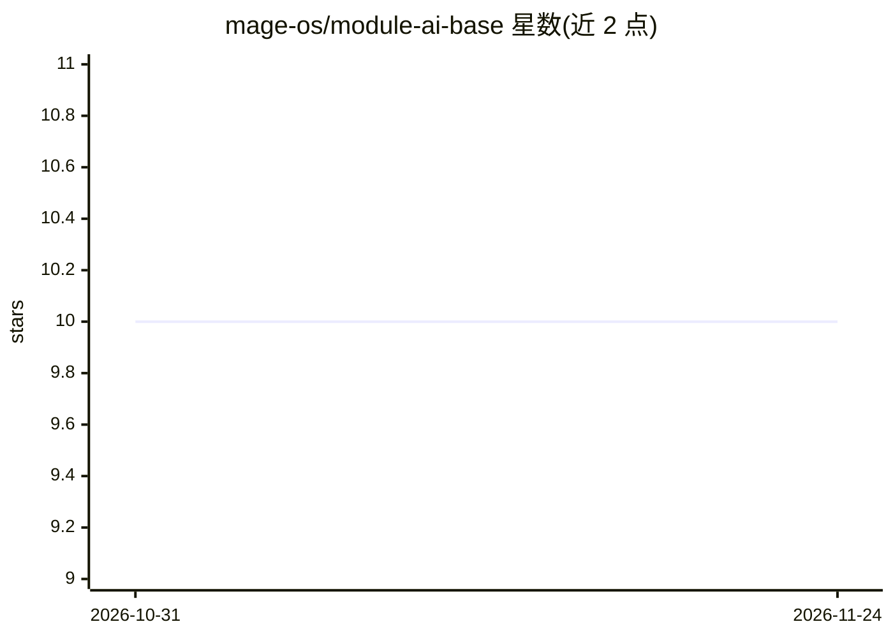

# mage-os/module-ai-base

⭐ 10 · PHP · NOASSERTION · 推送 2026-11-17 · [GitHub](https://github.com/mage-os/module-ai-base) · 组织维护

**Magento 统一配置与管理 AI 供应商及用量的基础模块**

面向 Magento/Mage-OS 电商后台的基础模块：集中配置多个 AI 供应商，为各模块提供统一客户端（聊天、流式、工具调用、推理），密钥加密存储；按模块/服务/店铺记录 token 用量，提供仪表盘、网格与 CLI 报告，且不存储提示词与响应。基于 symfony/ai-platform 0.15（实验版），除 OpenAI/Anthropic 外其余供应商需另装 Symfony AI 桥接包。需 Magento 2.4.8+ 或 Mage-OS 1.1+、PHP 8.2+。

## 筛选速览

| 维度 | 判定 | 备注 |
|---|---|---|
| AI 角色 | `ai-ecosystem` | LLM/agent 周边工具 |
| 许可风险 | `none` | NOASSERTION |
| 部署形态 | `None` |  |
| 模型依赖 | local-ok | 支持本地模型 |
| 硬件要求 | — | 无带数字的原话,不猜 |
| 安装摩擦 | `low` | 无编译、无系统依赖或容器化 |
| 成熟度 | — | 结构信号不足 |

## 能力要点

- 一处配置多供应商，提供跨供应商统一客户端（chat/streamChat/工具调用）
- token 用量按模块、服务、店铺追踪，含仪表盘、网格与 CLI 报告
- API key 加密存储且保存后不再回显，提示词与响应不存储
- 一个类加几行 di.xml 即可扩展自定义供应商

## 适用场景

- 为电商站的多个 AI 模块统一管理 API key 与模型选择
- 按模块统计和控制 AI token 花费
- 接入本地 Ollama 或 LM Studio 等 OpenAI 兼容后端

## 场景标签

`模型网关` · 领域:Agent 开发

## 证据(README 行号)

> L3: One place in Magento to configure your AI providers, one client every module can use to call them,
> L19: - **One client for every provider.** Chat, streaming, tool calls and reasoning through a single
> L24: - **Usage tracking.** Token counts per module, service and store, on a dashboard, a grid and a CLI

## 星数曲线

2026-10-31 10 → 2026-11-24 10（+0）

---
*卡片 v1 · prompt 1.4 · 生成 2026-11-20 · 置信度 high · 依据 README sha `eb6d6db73fe7` · [字段定义](../../DATASET.md)*
