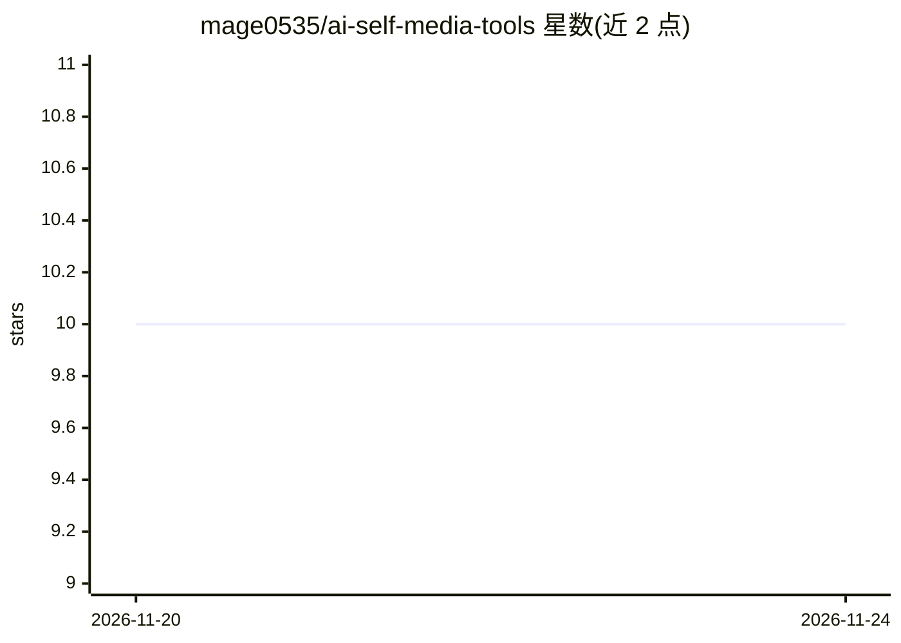

# mage0535/ai-self-media-tools

⭐ 10 · Python · MIT · 推送 2026-11-15 · [GitHub](https://github.com/mage0535/ai-self-media-tools) · [官网](https://github.com/mage0535/ai-self-media-tools) · 个人维护 · 中文 README

**面向自媒体运营者的多平台内容生成与发布工作流工具箱**

把账号数据复盘、趋势选题、内容规划、图文/视频生成、素材授权、质量门禁、草稿/交接/发布与发布后复盘串成一条可检查、可追踪的工作流，同时供自媒体运营者和 AI Agent 使用。核心机制是强约束门禁层：preflight_manifest、content_recipe、visual_recipe、tool_invocation_manifest 等清单必须通过代码门禁，BGM 需记录来源授权与指纹，失败即标记 blocked 禁止绕过。仓库只含公开源码与规则，账号 cookie、API Key 等私有数据需使用者自行绑定。

## 筛选速览

| 维度 | 判定 | 备注 |
|---|---|---|
| AI 角色 | `ai-native` | 本体是模型或模型工具 |
| 许可风险 | `permissive` | MIT |
| 部署形态 | `None` |  |
| 模型依赖 | — | README 未给出锁定关系 |
| 硬件要求 | — | 无带数字的原话,不猜 |
| 安装摩擦 | `low` | 无编译、无系统依赖或容器化 |
| 成熟度 | — | 结构信号不足 |

## 能力要点

- 覆盖 13+ 国内外平台的草稿、自动上传、handoff 包与 postcheck 流程
- 代码化质量门禁：preflight_manifest、content_recipe、visual_recipe 等清单校验
- BGM 门禁要求真实网络乐器音乐并记录来源、授权和指纹
- Trend Intelligence Cache 按新鲜度窗口缓存趋势快照，附 systemd 心跳监督进程

## 适用场景

- 多平台自媒体账号的选题、生成与发布流程管理
- 让 Hermes 等 Agent 按门禁规则执行自动运营任务
- 发布后采集播放、点赞、完播等数据反向更新增长策略

## 场景标签

`工作流自动化` `视频生成` `AI 写作` · 领域:效率与自动化

## 证据(README 行号)

> L5: AI Self-Media Tools 是一个面向自媒体运营者和 AI Agent 的多平台内容运营工具箱。它把账号数据复盘、运营策略、选题、图文/视频生成、素材授权、质量门禁、草稿/交接/发布和发布后复盘串成一条可检查、可追踪、可
> L24: 4. 内容生成：生成长文、图文、知识卡、短视频脚本、标题、正文、标签、SEO/GEO。
> L32: 当前版本已经把“规则写在文档里”升级为“规则必须进入代码门禁”：

## 星数曲线

2026-11-20 10 → 2026-11-24 10（+0）

---
*卡片 v1 · prompt 1.4 · 生成 2026-11-20 · 置信度 high · 依据 README sha `3cf148314eee` · [字段定义](../../DATASET.md)*
