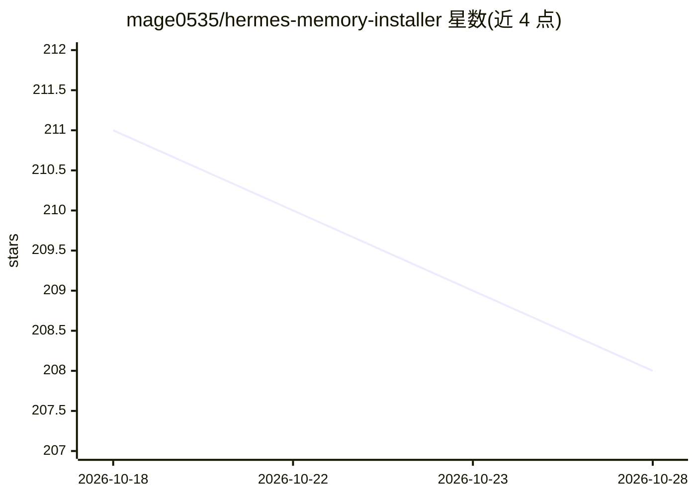

# mage0535/hermes-memory-installer

⭐ 208 · Python · MIT · 推送 2026-10-20 · [GitHub](https://github.com/mage0535/hermes-memory-installer) · [官网](https://github.com/mage0535/Knowledge-and-Memory-Management) · 个人维护 · 中文 README

**面向多种 AI 智能体的外挂式长期记忆边车系统**

以 sidecar 形式运行在 AI 智能体旁、不修改智能体核心的外部记忆系统：读取 AGENT_HOME 下的 state.db 与会话文件，把会话归档到 gbrain 与检索索引，重建治理索引，并为下一轮交互生成分层召回上下文；召回层覆盖热/温/冷数据与精选知识笔记，可融合 FTS5、Hindsight、gbrain 与可选语义嵌入检索。面向运行自有 Hindsight + gbrain + PostgreSQL 环境的技术用户，通过 install.sh 安装 28 个运行与可观测性脚本，附带告警、指标面板与 Prometheus/Grafana 模板。

## 筛选速览

| 维度 | 判定 | 备注 |
|---|---|---|
| AI 角色 | `ai-ecosystem` | LLM/agent 周边工具 |
| 许可风险 | `permissive` | MIT |
| 部署形态 | `desktop` | 安装包/桌面程序 |
| 模型依赖 | — | README 未给出锁定关系 |
| 硬件要求 | — | 无带数字的原话,不猜 |
| 安装摩擦 | `low` | 无编译、无系统依赖或容器化 |
| 成熟度 | — | 结构信号不足 |

## 能力要点

- 跨智能体通用（Hermes/Claude Code/Codex/Cursor），仅依赖 AGENT_HOME 数据边界
- hot/warm/curated 多层召回与语义嵌入可选支持
- 健康检查、告警队列、OpenMetrics 与 Grafana 面板等可观测性组件
- 安装器提供三档依赖模式与中英双语输出

## 适用场景

- 让长期运行的 AI 智能体在多会话、多项目间保留可召回记忆
- 把项目 playbook 与 wiki 笔记纳入智能体检索上下文
- 对记忆归档与召回运行做健康监控和告警

## 场景标签

`Agent 记忆` `多智能体` · 领域:Agent 开发

## 证据(README 行号)

> L20: Memory Sidecar is an external memory system that runs next to an AI agent without patching the agent itself. It rea
> L35: Memory Sidecar was built to make memory an installable, observable sidecar rather than a hidden agent-core modifica

## 星数曲线

2026-10-18 211 → 2026-10-28 208（-3）

---
*卡片 v1 · prompt 1.4 · 生成 2026-10-22 · 置信度 high · 依据 README sha `c57d0202cff9` · [字段定义](../../DATASET.md)*
