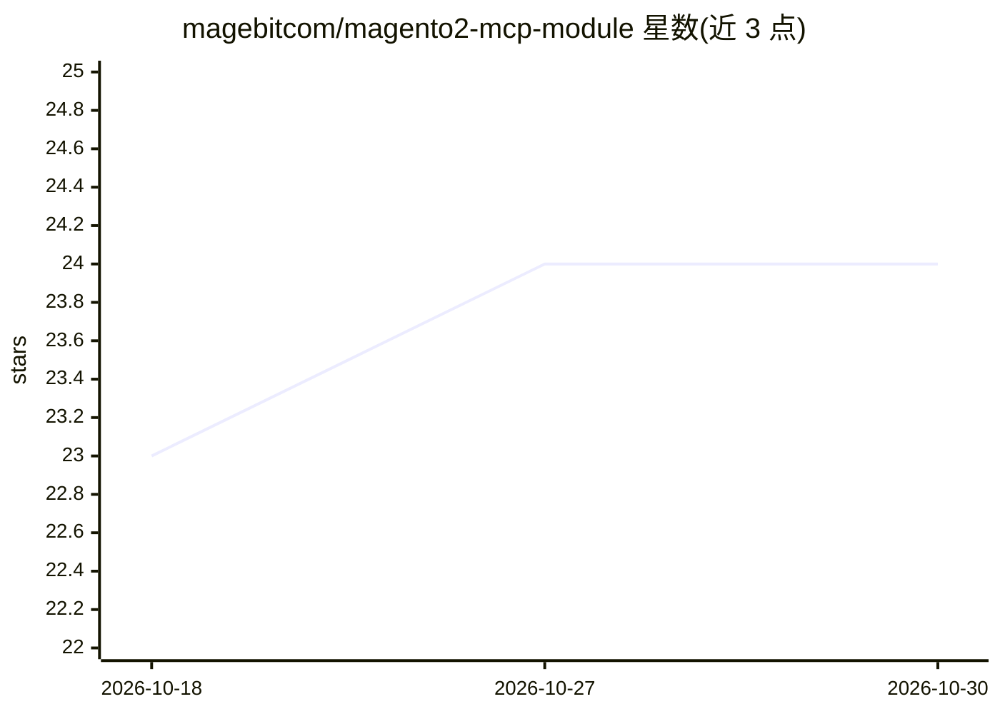

# magebitcom/magento2-mcp-module

⭐ 24 · PHP · MIT · 推送 2026-10-19 · [GitHub](https://github.com/magebitcom/magento2-mcp-module) · [官网](https://magebit.com/magento-mcp) · 组织维护

**面向 Magento 2 商店的 MCP 服务器：让 AI agent 读写店铺数据**

为 Magento 2 提供的可扩展 Model Context Protocol 服务器：通过 POST /mcp JSON-RPC 端点，让任意 MCP 兼容 AI agent 读取和修改客户、商品、CMS、销售数据，获取报表、管理配置。基础模块提供传输、bearer-token/OAuth 2.1 认证、按工具的 admin ACL、PII 脱敏审计日志、速率限制与来源白名单；领域功能拆分在订单、目录、库存、客户、CMS、营销、税务、报表、Google Analytics、数据库等可选子模块中，通过 composer 独立安装。安装需 Magento 2 环境并执行 module:enable 与 setup:upgrade。

## 筛选速览

| 维度 | 判定 | 备注 |
|---|---|---|
| AI 角色 | `ai-ecosystem` | LLM/agent 周边工具 |
| 许可风险 | `permissive` | MIT |
| 部署形态 | `None` |  |
| 模型依赖 | — | README 未给出锁定关系 |
| 硬件要求 | — | 无带数字的原话,不猜 |
| 安装摩擦 | `low` | 无编译、无系统依赖或容器化 |
| 成熟度 | — | 结构信号不足 |

## 能力要点

- POST /mcp JSON-RPC 端点，支持 bearer-token 与 OAuth 2.1 认证
- 按工具的 admin-role ACL、双层写入总开关与 PII 脱敏审计日志
- 九个领域子模块（订单/目录/库存/客户/CMS/营销/税务/报表等）按需 composer 安装
- 默认开启且仅限白名单的受保护 db.query 只读 SQL 工具

## 适用场景

- 运营通过 Claude、ChatGPT 等 AI agent 查询订单与店铺经营数据
- 让 AI agent 批量管理商品、库存与营销规则
- 排查计划任务与日志等店铺运维问题

## 场景标签

`数据分析` · 领域:效率与自动化

## 证据(README 行号)

> L5: Extensible Model Context Protocol server for Magento 2. Connect your store to any MCP-compatible AI agent — read and
> L13: - A `POST /mcp` JSON-RPC endpoint with bearer-token and OAuth 2.1 authentication

## 星数曲线

2026-10-18 23 → 2026-10-30 24（+1）

---
*卡片 v1 · prompt 1.4 · 生成 2026-10-27 · 置信度 high · 依据 README sha `8b3f5c17bfea` · [字段定义](../../DATASET.md)*
