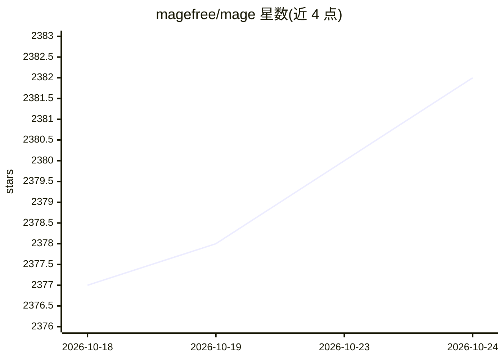

# magefree/mage

⭐ 2,382 · Java · MIT · 推送 2026-10-23 · [GitHub](https://github.com/magefree/mage) · [官网](https://xmage.today) · 组织维护

**支持 3.2 万张卡的万智牌规则引擎与在线对战平台**

基于 Java 的 Magic: The Gathering 完整规则校验引擎，采用客户端-服务器架构，收录超过 32000 张独立卡牌与 91000 余张重印版，支持双人决斗与最多 10 人多人游戏、轮抽、锦标赛、Glicko 积分系统与数十种赛制。提供电脑 AI 对手（含轮抽/组牌 AI），所有规则与隐藏信息由服务器端校验以防作弊。可连接公共服务器，也可自建服务器与 AI 离线对战；本地服务器带测试模式。需 Java 8 及以上运行启动器，跨 Windows/Linux/macOS。

## 筛选速览

| 维度 | 判定 | 备注 |
|---|---|---|
| AI 角色 | `ai-enhanced` | 去掉 AI 部分产品仍成立 |
| 许可风险 | `permissive` | MIT |
| 部署形态 | `None` |  |
| 模型依赖 | — | README 未给出锁定关系 |
| 硬件要求 | — | 无带数字的原话,不猜 |
| 安装摩擦 | `low` | 无编译、无系统依赖或容器化 |
| 成熟度 | — | 结构信号不足 |

## 能力要点

- 完整规则校验引擎，约 9000 个单元测试、约 80% 覆盖率
- 收录 32000+ 独立卡牌与 Star Wars 等自定义系列
- 电脑 AI 对手覆盖对局与轮抽/组牌
- 规则与隐藏信息均由服务器端校验，客户端不可见未授权数据

## 适用场景

- 与真人在线对战或与 AI 离线练习万智牌
- 自建私人服务器与朋友对战
- 在本地测试模式下复现特定组合技与对局局面
- 组织轮抽或瑞士轮/淘汰制锦标赛

## 场景标签

 · 领域:游戏/桌面应用

## 证据(README 行号)

> L7: XMage is a full rules-enforcement engine for playing Magic against other players or computer AI,
> L35: * Smart and fast AI opponents for both games and draft/deck-building;

## 星数曲线

2026-10-18 2,377 → 2026-10-24 2,382（+5）

---
*卡片 v1 · prompt 1.4 · 生成 2026-10-21 · 置信度 high · 依据 README sha `a549c2fa2acf` · [字段定义](../../DATASET.md)*
