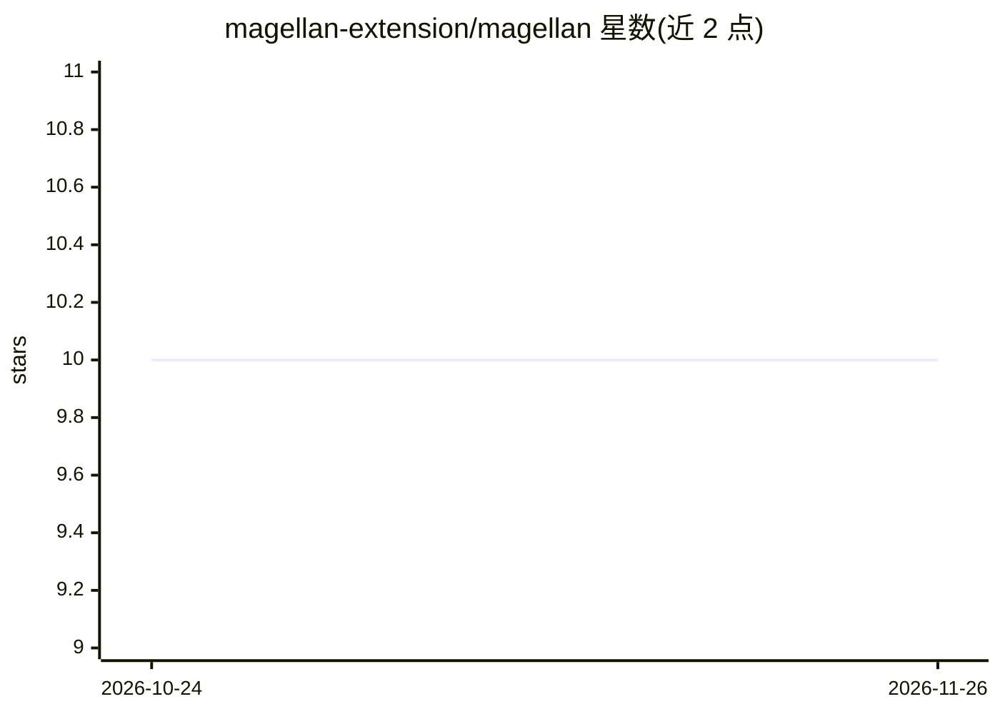

# magellan-extension/magellan

⭐ 10 · JavaScript · MIT · 推送 2026-01-30 · [GitHub](https://github.com/magellan-extension/magellan) · [官网](https://kpulgari.com/magellan/) · 组织维护

**浏览器 AI 研究助手扩展：对任意网页提问并给出带引用的回答**

开源 Chrome 扩展，将浏览器转为 AI 研究助手：对当前网页或上传文档提问，返回带高亮引用标注的回答。提供三种检索模式（仅页面上下文、页面与通用知识混合、纯通用知识），支持 PDF/TXT/DOC/DOCX/MD/RTF 多格式文档上传，自动抽取引用并支持页面内定位跳转。可选实时网络搜索；模型通过 OpenRouter 接入，可选数百个模型，含有限额的免费模型。对话历史按标签页持久保存。安装途径为 Chrome 商店、Release 压缩包或源码加载。

## 筛选速览

| 维度 | 判定 | 备注 |
|---|---|---|
| AI 角色 | `ai-native` | 本体是模型或模型工具 |
| 许可风险 | `permissive` | MIT |
| 部署形态 | `desktop` | 安装包/桌面程序 |
| 模型依赖 | locked-api |  |
| 硬件要求 | — | 无带数字的原话,不猜 |
| 安装摩擦 | `low` | 无编译、无系统依赖或容器化 |
| 成熟度 | — | 结构信号不足 |

## 能力要点

- 三种检索模式：Page Context / Blended / General Knowledge
- 自动引用抽取与页面高亮定位
- 通过 OpenRouter 接入数百个模型（含免费模型）
- 支持 PDF、TXT、DOC、DOCX、MD、RTF 文档分析

## 适用场景

- 阅读文章或研究课题时对页面内容直接提问
- 上传文档并基于文档内容做问答分析
- 需要带引用来源的可核验回答

## 场景标签

`文档问答` · 领域:知识与检索

## 证据(README 行号)

> L7: Magellan is an open-source Chrome extension that transforms your browser into an intelligent AI research assistant. 
> L28: - 🤖 **Flexible AI Model Selection** – Choose from hundreds of AI models via OpenRouter

## 星数曲线

2026-10-24 10 → 2026-11-26 10（+0）

---
*卡片 v1 · prompt 1.4 · 生成 2026-11-19 · 置信度 high · 依据 README sha `bfe77f512c82` · [字段定义](../../DATASET.md)*
