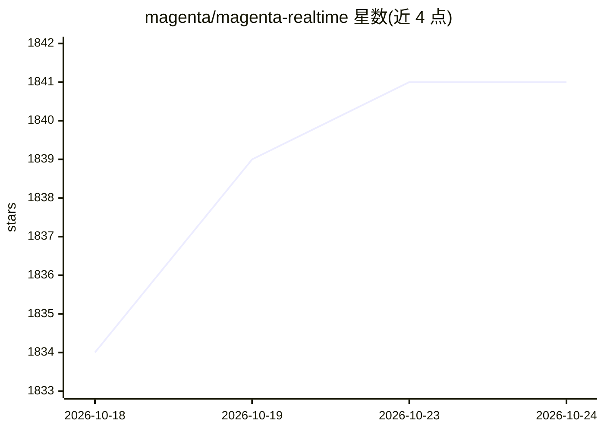

# magenta/magenta-realtime

⭐ 1,840 · Python · Apache-2.0 · 推送 2026-10-02 · [GitHub](https://github.com/magenta/magenta-realtime) · [官网](https://magenta.withgoogle.com/magenta-realtime-2) · 组织维护

**开放权重实时音乐生成模型及配套推理库与应用套件**

Magenta RealTime 2 提供开放权重的实时音乐生成模型（230M 与 2.4B 两种规模），配套 Python 推理库 magenta-rt（JAX/MLX 后端）、面向 Apple Silicon 的 C++ 流式推理引擎 magentart::core，以及 AUv3 DAW 插件、独立 macOS 应用等示例。实时流式生成要求 Apple Silicon（M 系列），小模型可实时运行于任意 Apple Silicon Mac，base 模型需 Pro Max 级芯片；离线推理支持任意 Apple Silicon 或 NVIDIA GPU。面向希望运行推理、构建 DAW 插件或嵌入模型的应用开发者。

## 筛选速览

| 维度 | 判定 | 备注 |
|---|---|---|
| AI 角色 | `ai-native` | 本体是模型或模型工具 |
| 许可风险 | `permissive` | Apache-2.0 |
| 部署形态 | `library` | 以包/库形式分发 |
| 模型依赖 | — | README 未给出锁定关系 |
| 硬件要求 | — | 无带数字的原话,不猜 |
| 安装摩擦 | `low` | 无编译、无系统依赖或容器化 |
| 成熟度 | — | 结构信号不足 |

## 能力要点

- 开放权重实时音乐生成模型，提供 230M 与 2.4B 两种规模
- Python 库 magenta-rt 支持 JAX 与 MLX 后端，可离线运行于 Apple Silicon 或 NVIDIA GPU
- C++ 推理引擎 magentart::core 用于 Apple Silicon 流式音频生成
- 附带 AUv3 DAW 插件与独立 macOS 应用等示例

## 适用场景

- 在 Mac 上实时生成交互式音乐
- 构建 DAW 插件或把实时音乐模型嵌入新应用
- 用 Python/Jupyter 试探模型与提示空间

## 场景标签

`推理引擎` · 领域:训练与推理

## 证据(README 行号)

> L8: Magenta RealTime 2 (MRT2) is a state-of-the-art open-weights model for real-time music generation. It contains sever
> L11: * A C++ inference engine `magentart::core` for efficient streaming audio generation on Apple Silicon MacBooks

## 星数曲线

2026-10-18 1,834 → 2026-10-24 1,841（+7）

---
*卡片 v1 · prompt 1.4 · 生成 2026-10-21 · 置信度 mid · 依据 README sha `4b86f23b6053` · [字段定义](../../DATASET.md)*
