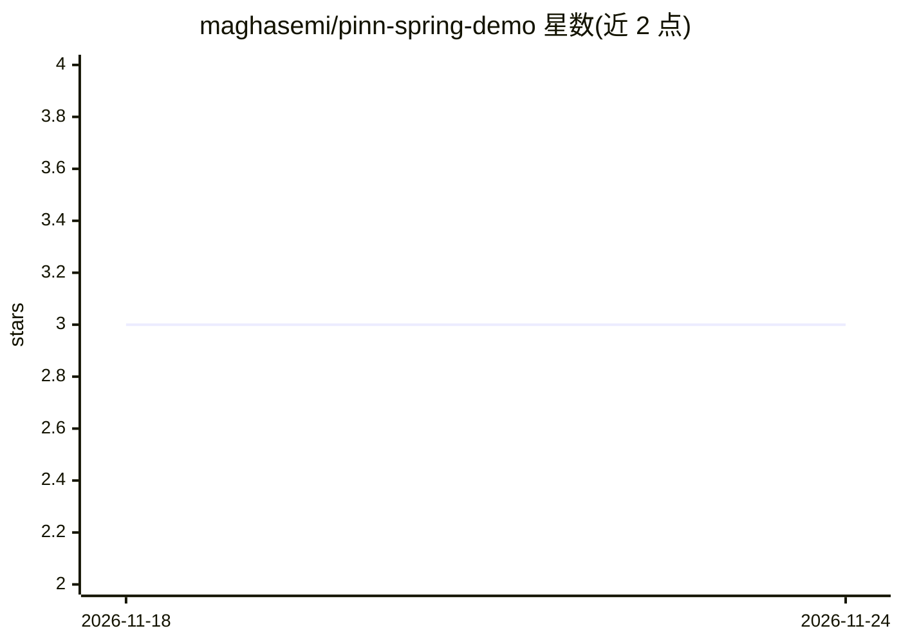

# maghasemi/pinn-spring-demo

⭐ 3 · Python · MIT · 推送 2026-11-07 · [GitHub](https://github.com/maghasemi/pinn-spring-demo) · 个人维护

**PINN 阻尼弹簧演示：12 个数据点加一条方程的 PyTorch 教学**

用 PyTorch 实现的物理信息神经网络（PINN）演示项目：以阻尼弹簧方程 u'' + 2d u' + ω²u = 0 作为物理约束，与 12 个含噪观测点一起构成损失函数训练网络。README 展示三组对照结果：仅数据训练误差 65%-228%，数据加物理约束误差降至 0.4%-1.0%，反向问题中网络可从错误初值学得阻尼参数。CPU 上几分钟即可训练，render_demo.py 依赖 ffmpeg 生成演示视频。作者注明这是小型玩具问题，不证明对真实系统的适用性。

## 筛选速览

| 维度 | 判定 | 备注 |
|---|---|---|
| AI 角色 | `ai-native` | 本体是模型或模型工具 |
| 许可风险 | `permissive` | MIT |
| 部署形态 | `library` | 以包/库形式分发 |
| 模型依赖 | — | README 未给出锁定关系 |
| 硬件要求 | — | 无带数字的原话,不猜 |
| 安装摩擦 | `medium` | 含编译或系统依赖之一 |
| 成熟度 | — | 结构信号不足 |

## 能力要点

- 数据误差与物理方程残差相加的 PINN 损失设计
- 对照实验：仅数据 vs 数据+物理（4 个随机种子）
- 反向问题：阻尼系数作为可训练参数被学出
- CPU 可运行，训练数分钟

## 适用场景

- 学习 PINN 的基本原理与实现
- 教学演示物理约束如何提升小数据拟合
- 在此基础上修改方程做实验

## 场景标签

`教程课程` · 领域:学习与行业

## 证据(README 行号)

> L7: A normal neural network sees 12 noisy measurements of a damped spring and has no idea what comes next. Give the same
> L60: `train_demo.py` trains the three networks on the CPU, which takes a few minutes, and prints the error of each. `ren

## 星数曲线

2026-11-18 3 → 2026-11-24 3（+0）

---
*卡片 v1 · prompt 1.4 · 生成 2026-11-21 · 置信度 high · 依据 README sha `df2b8d59fe96` · [字段定义](../../DATASET.md)*
