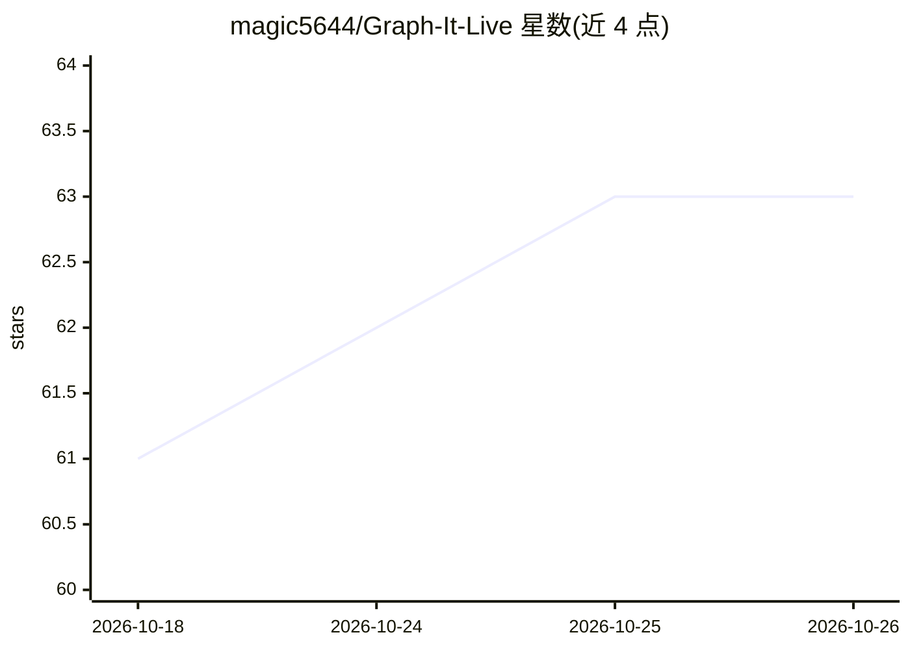

# magic5644/Graph-It-Live

⭐ 63 · TypeScript · MIT · 推送 2026-10-24 · [GitHub](https://github.com/magic5644/Graph-It-Live) · [官网](https://magic5644.github.io/Graph-It-Live/) · 个人维护

**把代码库可视化为依赖图的 VS Code 扩展/CLI/MCP 工具**

面向开发者的代码结构分析工具，以三种形态提供：VS Code 扩展、独立 CLI 与面向 GitHub Copilot 等 AI 客户端的 MCP/native tool provider。通过正则、AST、Tree-sitter 与 SQLite 分析导入、符号、调用、循环依赖、未用导出与变更影响，输出文件依赖图、符号视图、跨文件 Live Call Graph 与工作区架构视图（含单元角色推断与循环标记）。分析在本地运行并返回代码库证据。支持 TypeScript/JavaScript/Python/Rust/C#/Go/Java/Vue/Svelte/GraphQL 等语言，Symbol View 目前限 TS/JS/Python/Rust。

## 筛选速览

| 维度 | 判定 | 备注 |
|---|---|---|
| AI 角色 | `ai-ecosystem` | LLM/agent 周边工具 |
| 许可风险 | `permissive` | MIT |
| 部署形态 | `self-host` | docker 或自建部署 |
| 模型依赖 | — | README 未给出锁定关系 |
| 硬件要求 | — | 无带数字的原话,不猜 |
| 安装摩擦 | `low` | 无编译、无系统依赖或容器化 |
| 成熟度 | — | 结构信号不足 |

## 能力要点

- 文件图/符号视图/跨文件 Live Call Graph 三种视图
- 架构视图按单元分层并推断角色（function/frontend/service 等）
- 作为 MCP/native tool provider 向 AI 客户端提供聚焦上下文
- 本地运行分析，返回代码库证据

## 适用场景

- 可视化浏览项目依赖与循环依赖
- 审查重构影响面、查找反向依赖
- 为 AI 助手提供聚焦的代码上下文而非整个源文件
- 生成代码结构图（codemap）

## 场景标签

 · 领域:开发者工具/代码分析

## 证据(README 行号)

> L14: Graph-It-Live analyzes imports, symbols, calls, cycles, unused exports, and change impact. Use it as a VS Code exte
> L28: Use the same graph data to navigate code, review refactors, generate codemaps, and give AI assistants focused conte

## 星数曲线

2026-10-18 61 → 2026-10-26 63（+2）

---
*卡片 v1 · prompt 1.4 · 生成 2026-10-24 · 置信度 mid · 依据 README sha `f0bab3fa5332` · [字段定义](../../DATASET.md)*
