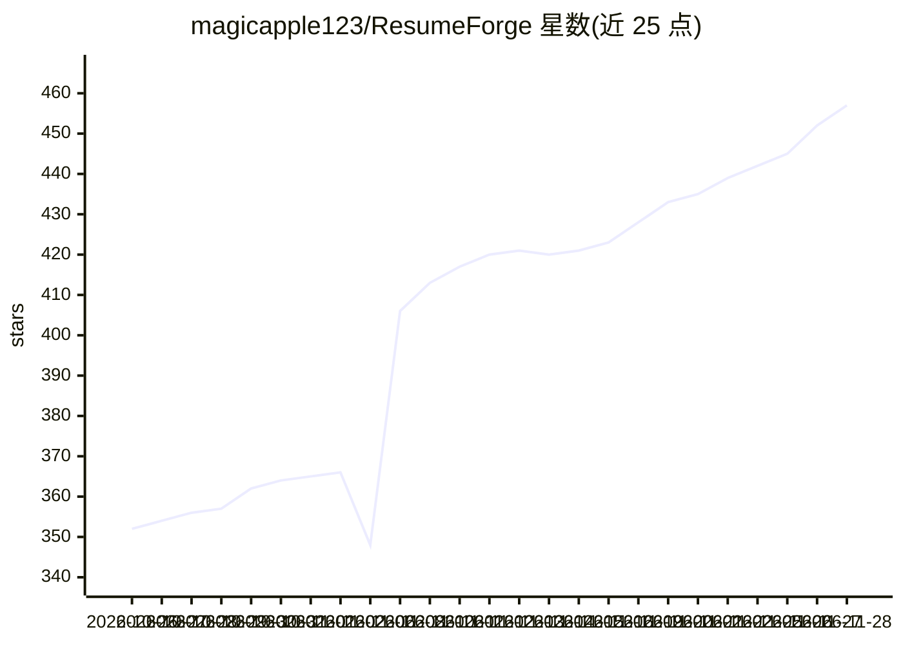

# magicapple123/ResumeForge

⭐ 457 · Python · Apache-2.0 · 推送 2026-11-27 · [GitHub](https://github.com/magicapple123/ResumeForge) · [官网](https://magicapple123.github.io/ResumeForge-official/) · 个人维护 · 中文 README

**求职者的本地简历工作台：生成简历并防编造**

本地运行的简历编辑与求职流程管理工具，覆盖职位解析、匹配分析、简历排版（页面概览、分页报告、A4 精确预览）、多格式导出、投递跟踪、模拟面试与求职统计。关键机制是事实与措辞分离：生成内容逐条对照 Profile 库，不一致触发防编造警告，含【待补】标记时阻止导出。无账号，数据留在本机；Windows/macOS 提供安装包，首启动脚本自动准备环境。

## 筛选速览

| 维度 | 判定 | 备注 |
|---|---|---|
| AI 角色 | `ai-enhanced` | 去掉 AI 部分产品仍成立 |
| 许可风险 | `permissive` | Apache-2.0 |
| 部署形态 | `desktop` | 安装包/桌面程序 |
| 模型依赖 | locked-api |  |
| 硬件要求 | — | 无带数字的原话,不猜 |
| 安装摩擦 | `low` | 无编译、无系统依赖或容器化 |
| 成熟度 | — | 结构信号不足 |

## 能力要点

- 事实账本：仅"已确认"条目参与生成，未确认条目显式回避
- 无文本层扫描件的 OCR 识别（Auto/仅 OCR/仅视觉三档引擎策略）
- JD 解析、逐行匹配分析（五种结论类型，无百分比）与 2-12 个职位批量对比
- 13 个板块的 Profile 库与 Plan 机制，控制送入模型与纸面的内容范围

## 适用场景

- 从职位描述到面试复盘全程管理求职材料
- 生成简历时防止模型编造不存在的经历
- 本地敏感信息不出机器的前提下使用 AI 简历生成
- 批量跟踪多个职位的投递状态与分析历史

## 场景标签

`OCR` `AI 写作` · 领域:内容生成

## 证据(README 行号)

> L14: **A local-first AI resume workbench: no account, no sign-in, and all data stays on your machine.**
> L56: A second problem matters more: **generative models polish wording and also fabricate.** The greatest risk in a resu
> L84: |🔍 Scanned-document OCR|Scanned PDFs and certificate photos with **no text layer** are recognized into text instead

## 星数曲线

2026-10-26 352 → 2026-11-28 457（+105）

---
*卡片 v1 · prompt 1.4 · 生成 2026-11-28 · 置信度 high · 依据 README sha `e9184f8af4c3` · [字段定义](../../DATASET.md)*
