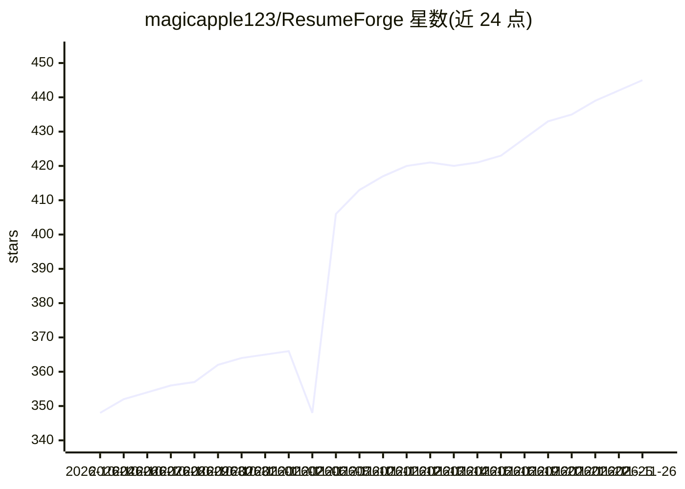

# magicapple123/ResumeForge

⭐ 445 · Python · Apache-2.0 · 推送 2026-11-25 · [GitHub](https://github.com/magicapple123/ResumeForge) · [官网](https://magicapple123.github.io/ResumeForge-official/) · 个人维护 · 中文 README

**本地优先的 AI 简历工作台：求职全流程管理+防编造**

本地运行的求职材料工作台，覆盖从职位解析、匹配分析、简历生成、多格式导出到投递跟踪、模拟面试与复盘的完整流程。核心机制是将事实与措辞分离：Profile 库与 Fact ledger 中只有「confirmed」条目参与生成，生成结果逐条比对以触发防编造警告，含未填标记时阻断导出。无账号体系，数据留在本机，Windows/macOS 提供安装包与便携版。

## 筛选速览

| 维度 | 判定 | 备注 |
|---|---|---|
| AI 角色 | `ai-enhanced` | 去掉 AI 部分产品仍成立 |
| 许可风险 | `permissive` | Apache-2.0 |
| 部署形态 | `desktop` | 安装包/桌面程序 |
| 模型依赖 | local-ok | 支持本地模型 |
| 硬件要求 | — | 无带数字的原话,不猜 |
| 安装摩擦 | `low` | 无编译、无系统依赖或容器化 |
| 成熟度 | — | 结构信号不足 |

## 能力要点

- Fact ledger 事实账本：仅 confirmed 条目参与生成，阻断编造内容导出
- JD 解析、逐行匹配分析（5 种判定类型）与批量/多职位对比分析
- 扫描件 OCR 识别支持 DeepSeek/纯 OCR/纯视觉三种引擎可选
- A4 精确预览、分页报告与布局诊断，本地渲染导出 PDF

## 适用场景

- 集中管理多个职位的投递进度与版本对应关系
- 针对职位描述生成简历并防止模型编造经历
- 面试前用模拟面试与 JD 分析做准备
- 无账号、离线环境下管理求职材料

## 场景标签

`OCR` `AI 写作` · 领域:内容生成

## 证据(README 行号)

> L14: **A local-first AI resume workbench: no account, no sign-in, and all data stays on your machine.**
> L56: A second problem matters more: **generative models polish wording and also fabricate.** The greatest risk in a resu

## 星数曲线

2026-10-24 348 → 2026-11-26 445（+97）

---
*卡片 v1 · prompt 1.4 · 生成 2026-11-25 · 置信度 high · 依据 README sha `672968d3fd53` · [字段定义](../../DATASET.md)*
