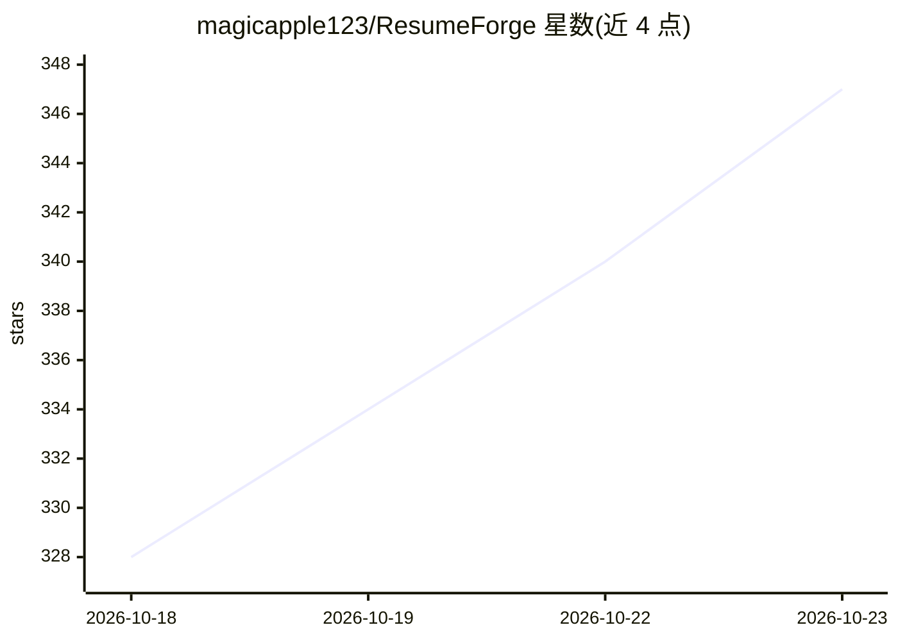

# magicapple123/ResumeForge

⭐ 347 · Python · Apache-2.0 · 推送 2026-10-22 · [GitHub](https://github.com/magicapple123/ResumeForge) · [官网](https://github.com/magicapple123/ResumeForge#readme) · 个人维护 · 中文 README

**本地优先的 AI 简历工作台：求职全流程资料管理**

面向求职者的单机自托管应用（FastAPI + React + SQLite），覆盖岗位管理、AI/手写简历生成、多格式导出、网申自动填表、自动投递、模拟面试与求职数据看板。核心机制是「事实台账」：生成结果中的学校/公司/项目名与资料库逐条比对，不一致时给出防虚构警告；含【待补】标记时导出被拦截。默认不访问招聘网站，数据存本机；断网时解析、检查、导出均可用。支持 Windows/macOS 安装包与源码一键启动，内置 16 个模型服务预设。

## 筛选速览

| 维度 | 判定 | 备注 |
|---|---|---|
| AI 角色 | `ai-native` | 本体是模型或模型工具 |
| 许可风险 | `permissive` | Apache-2.0 |
| 部署形态 | `desktop` | 安装包/桌面程序 |
| 模型依赖 | local-ok | 支持本地模型 |
| 硬件要求 | — | 无带数字的原话,不猜 |
| 安装摩擦 | `low` | 无编译、无系统依赖或容器化 |
| 成熟度 | — | 结构信号不足 |

## 能力要点

- 事实台账与防虚构校验：只有「已确认」的事实参与简历生成
- AI 按 JD 单独生成简历，生成内容逐段溯源到资料库
- 内置 16 个模型服务预设，可切换接口协议，支持本地 Ollama
- 六种格式导出（PDF/Word/Markdown/txt/JSON/HTML）与一键脱敏、水印

## 适用场景

- 管理求职期间的岗位、简历、投递进度等分散资料
- 按岗位 JD 定制简历并防止 AI 编造经历
- 用本机浏览器自动填写公司官网网申表单（只填不交）
- 模拟面试与面试深挖练习，复盘改进简历

## 场景标签

`AI 写作` `浏览器自动化` · 领域:效率与自动化

## 证据(README 行号)

> L13: **本地优先的 AI 简历工作台：不注册、不登录，数据只存在你自己的电脑上。**
> L41: 更要紧的是另一个问题：**AI 会替你把简历写得很漂亮，也会替你编。** 简历工具最危险的行为不是排版难看，而是把你没做过的事写进去——面试官追问两句就露馅。所以 ResumeForge 把「事实」从「表述」里拆出来单独管：生成结
> L217: |🔑 你的 Key 你做主|内置 16 个服务预设（DeepSeek / Claude / 豆包 / OpenAI / Ollama …），可取可用模型、调高级参数，并可切换接口协议|

## 星数曲线

2026-10-18 328 → 2026-10-23 347（+19）

---
*卡片 v1 · prompt 1.4 · 生成 2026-10-22 · 置信度 mid · 依据 README sha `02d2a8f7e0e2` · [字段定义](../../DATASET.md)*
