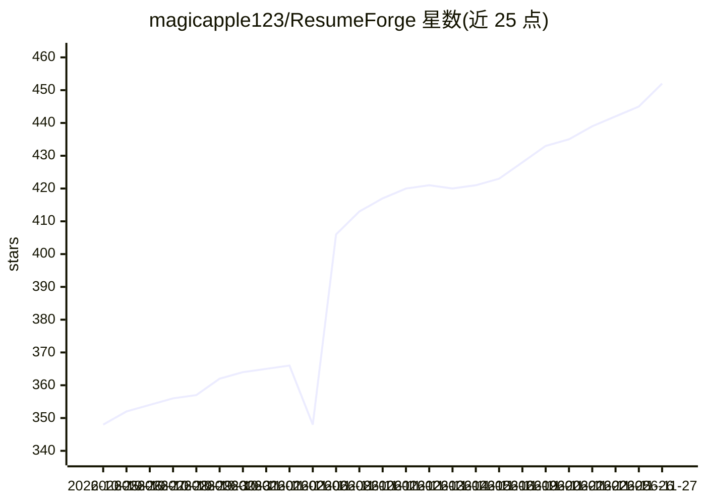

# magicapple123/ResumeForge

⭐ 452 · Python · Apache-2.0 · 推送 2026-11-26 · [GitHub](https://github.com/magicapple123/ResumeForge) · [官网](https://magicapple123.github.io/ResumeForge-official/) · 个人维护 · 中文 README

**本地优先的 AI 简历工作台：防编造、多格式导出与求职追踪**

一个本地优先的求职材料工作台，覆盖从 JD 解析、匹配分析、简历生成排版到投递追踪、模拟面试与复盘的流程。关键机制是将事实与措辞分离维护：Fact Ledger 记录每条事实的措辞与边界，生成内容逐条与 Profile 库比对并给出防编造警告，含【待补】标记时阻止导出。无账号、数据留在本机；桌面构建版提供 Windows 安装包与 macOS dmg，演示版为只读回放。

## 筛选速览

| 维度 | 判定 | 备注 |
|---|---|---|
| AI 角色 | `ai-enhanced` | 去掉 AI 部分产品仍成立 |
| 许可风险 | `permissive` | Apache-2.0 |
| 部署形态 | `desktop` | 安装包/桌面程序 |
| 模型依赖 | local-ok | 支持本地模型 |
| 硬件要求 | — | 无带数字的原话,不猜 |
| 安装摩擦 | `low` | 无编译、无系统依赖或容器化 |
| 成熟度 | — | 结构信号不足 |

## 能力要点

- Fact Ledger 事实台账：仅“已确认”条目参与生成，未确认内容被规避
- 生成内容与 Profile 库逐条比对，不一致触发防编造警告，含【待补】标记时阻止导出
- JD 解析、逐行匹配分析（5 类判定不带百分比）、批量与后台分析
- 无文字层扫描件的 OCR 识别可选 Auto/仅 OCR/仅视觉三种引擎，文本 PDF 走本地 pypdf

## 适用场景

- 从职位描述到面试复盘全程在本地管理求职材料
- 生成简历时阻止模型写出从未发生的内容
- 投多家公司时追踪每版简历去向与申请进度
- 离线处理含扫描件的证书与简历材料

## 场景标签

`AI 写作` `文档解析` `OCR` · 领域:内容生成

## 证据(README 行号)

> L14: **A local-first AI resume workbench: no account, no sign-in, and all data stays on your machine.**
> L56: A second problem matters more: **generative models polish wording and also fabricate.** The greatest risk in a resu
> L82: |🧾 Fact ledger|Every claim records the fact, the wording, how strongly you own it and its boundary; **only “confirm

## 星数曲线

2026-10-25 348 → 2026-11-27 452（+104）

---
*卡片 v1 · prompt 1.4 · 生成 2026-11-26 · 置信度 high · 依据 README sha `965072d19f05` · [字段定义](../../DATASET.md)*
