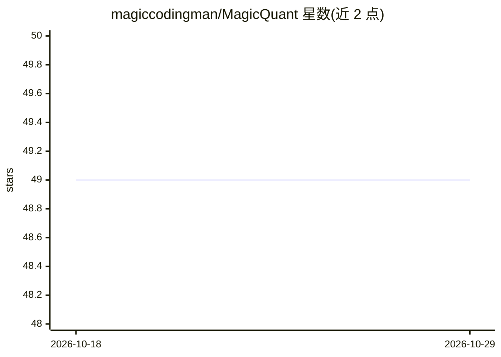

# magiccodingman/MagicQuant

⭐ 49 · C# · AGPL-3.0 · 推送 2026-09-08 · [GitHub](https://github.com/magiccodingman/MagicQuant) · 个人维护

**面向 llama.cpp 的混合精度 GGUF 量化搜索与基准工具**

MagicQuant 是一个 CLI 工具与流程，用于为 LLM 发现混合精度 GGUF 量化方案：读取基线（llama.cpp）及可选外部 GGUF（如 Unsloth）的张量分配，按架构感知组（embedding/attention/前馈/输出头/MoE）组织，测量孤立组替换的影响，用预测器与 DuckDB 搜索候选组合，构建并基准实测真实 GGUF，以体积与输出分布散度（KLD）筛选留存方案；同时导出模型卡、测量结果与可克隆的张量映射清单，供在兼容微调上重建。面向本地量化实验的开发者，以 .NET/NuGet 形式提供。

## 筛选速览

| 维度 | 判定 | 备注 |
|---|---|---|
| AI 角色 | `ai-ecosystem` | LLM/agent 周边工具 |
| 许可风险 | `viral` | AGPL-3.0 |
| 部署形态 | `None` |  |
| 模型依赖 | local-ok | 支持本地模型 |
| 硬件要求 | — | 无带数字的原话,不猜 |
| 安装摩擦 | `medium` | 含编译或系统依赖之一 |
| 成熟度 | — | 结构信号不足 |

## 能力要点

- 从现有 GGUF 学习张量配方并按架构感知分组
- 孤立测量+预测搜索+真实 GGUF 基准的发现流程
- 以体积/KLD 贸易筛选留存方案并剔除被支配项
- 导出 clone manifest，可在兼容微调上重建与重测配方

## 适用场景

- 为本地模型寻找比固定 Q4/Q5/Q6 标签更优的体积-保真权衡
- 把发现的量化配方克隆到相关微调或变体模型上重建
- 发布带测量证据与可复现配方的 GGUF 系列

## 场景标签

`模型量化` · 领域:训练与推理

## 证据(README 行号)

> L12: MagicQuant discovers **mixed-precision GGUF quantizations for llama.cpp** that offer better measured tradeoffs betw
> L16: MagicQuant investigates those opportunities for your model. It measures group changes, predicts promising combinati

## 星数曲线

2026-10-18 49 → 2026-10-29 49（+0）

---
*卡片 v1 · prompt 1.4 · 生成 2026-10-24 · 置信度 high · 依据 README sha `f7e3a322e58e` · [字段定义](../../DATASET.md)*
