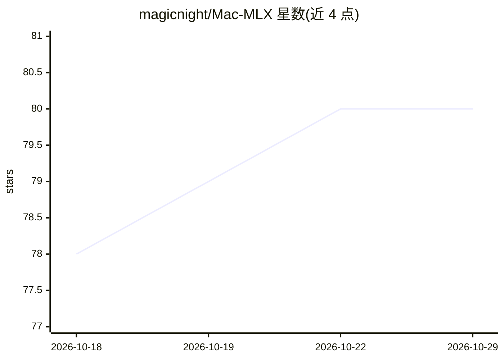

# magicnight/Mac-MLX

⭐ 80 · Swift · NOASSERTION · 推送 2026-10-28 · [GitHub](https://github.com/magicnight/Mac-MLX) · [官网](https://macmlx.app/) · 个人维护 · 中文 README

**Apple Silicon 本地 LLM 原生 macOS 推理应用（GUI+CLI+API）**

面向 Apple Silicon Mac 用户的本地 LLM 推理工具：SwiftUI 图形界面、macmlx CLI 与常驻的 OpenAI 兼容 API 服务（:8000）。核心引擎为 Swift 编写的进程内 MLX 引擎，支持文本与 16 种 VLM 架构（至约 70B 模型）、连续批处理、分层 KV 缓存、投机解码、LoRA、结构化输出、语音转写与合成、MCP server。以 DMG 安装包分发（未公证，需清除 Gatekeeper 隔离），也可从源码构建；要求 macOS 14.0+ 与 M1–M4 芯片，无需 Python。

## 筛选速览

| 维度 | 判定 | 备注 |
|---|---|---|
| AI 角色 | `ai-ecosystem` | LLM/agent 周边工具 |
| 许可风险 | `none` | NOASSERTION |
| 部署形态 | `desktop` | 安装包/桌面程序 |
| 模型依赖 | local-ok | 支持本地模型 |
| 硬件要求 | — | 无带数字的原话,不猜 |
| 安装摩擦 | `medium` | 含编译或系统依赖之一 |
| 成熟度 | — | 结构信号不足 |

## 能力要点

- 进程内 Swift 引擎运行 MLX 推理（文本+16 种 VLM，至约 70B）
- 常驻 OpenAI 兼容 API，兼有 Ollama NDJSON 与 Anthropic /v1/messages 兼容层
- 结构化输出、连续批处理、分层 KV 缓存、投机解码、LoRA、MCP server
- GUI/CLI 共享同一 Swift 核心，活动面板提供无 sudo 的 GPU/内存/功耗读数

## 适用场景

- 在 Mac 上本地运行 LLM 进行对话与推理，无需云端
- 把 Cursor、Continue、Zed 等工具指向本地 OpenAI 兼容 API
- 用 CLI 下载、运行模型并对外提供推理服务

## 场景标签

`推理引擎` `AI 助手` · 领域:对话与助手

## 证据(README 行号)

> L9: newcomers, a proper CLI for developers, and an always-on OpenAI-compatible
> L63: - **API** — always-on OpenAI-compatible server plus Ollama (NDJSON) and Anthropic (`/v1/messages`) compatibility; *
> L80: macmlx serve                                 # API on :8000

## 星数曲线

2026-10-18 78 → 2026-10-29 80（+2）

---
*卡片 v1 · prompt 1.4 · 生成 2026-10-24 · 置信度 high · 依据 README sha `9d68e59b20b3` · [字段定义](../../DATASET.md)*
