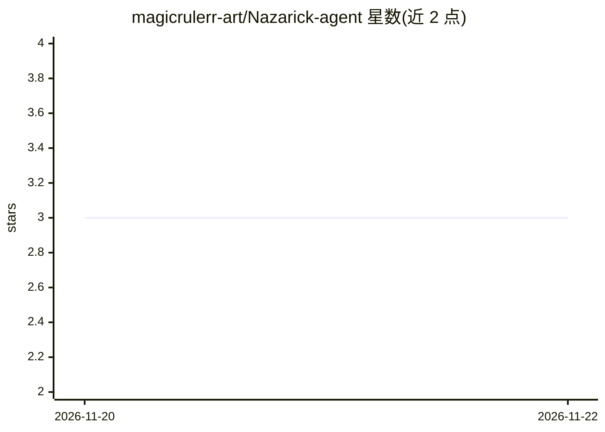

# magicrulerr-art/Nazarick-agent

⭐ 3 · Kotlin · AGPL-3.0 · 推送 2026-11-21 · [GitHub](https://github.com/magicrulerr-art/Nazarick-agent) · [官网](https://github.com/magicrulerr-art/Nazarick-agent/releases/latest) · 个人维护 · 中文 README

**全离线 Android AI agent：本地 LLM 加工具调用与 NPU 生图**

运行在 Android 8+ 上的本地 agent 应用，内置 llama.cpp 引擎（以固定 SHA 编译进 APK），提供约 180 个工具（57 组）、权限策略引擎、可并行调度的 sub-agents、工作流与本地冷记忆存储；上下文规划器按可用 RAM 选定 KV cache 档位，支持 GPU 层 offload（OpenCL/Vulkan 路径）与运行时参数调节，无需服务器、账号或联网调用。由 rikkahub 系列多阶段演化而来，AGPL-3.0 许可。

## 筛选速览

| 维度 | 判定 | 备注 |
|---|---|---|
| AI 角色 | `ai-native` | 本体是模型或模型工具 |
| 许可风险 | `viral` | AGPL-3.0 |
| 部署形态 | `None` |  |
| 模型依赖 | local-ok | 支持本地模型 |
| 硬件要求 | — | 无带数字的原话,不猜 |
| 安装摩擦 | `medium` | 含编译或系统依赖之一 |
| 成熟度 | `idea` | |

## 能力要点

- 内置 llama.cpp fork 的本地推理引擎，支持 OpenCL/Vulkan GPU 层 offload
- 约 180 个工具、权限策略引擎、sub-agents 与工作流链式调用
- 上下文规划器按设备内存规划 KV cache 并动态取舍工具
- 本地嵌入模型支撑离线 RAG，EmbeddingGemma 2 作为声明式前置条件

## 适用场景

- 在无网络环境下用手机运行带工具调用的 LLM agent
- 让 agent 本地读取设备状态（如电量）并执行操作
- 在 Adreno GPU 设备上做全层 offload 的本地推理实验

## 场景标签

`推理引擎` `图像生成` `RAG` `Agent 框架` · 领域:Agent 开发

## 证据(README 行号)

> L23: Nazarick Agent is an **agent** on a phone. It carries a tool directory of ~180 tools across 57 groups, a policy eng
> L49: **RikkaHub is a footnote now, and this is the line that says so.** We kept its Compose surface, its provider plumbi

## 星数曲线

2026-11-20 3 → 2026-11-22 3（+0）

---
*卡片 v1 · prompt 1.4 · 生成 2026-11-21 · 置信度 high · 依据 README sha `5e4d46a583d0` · [字段定义](../../DATASET.md)*
