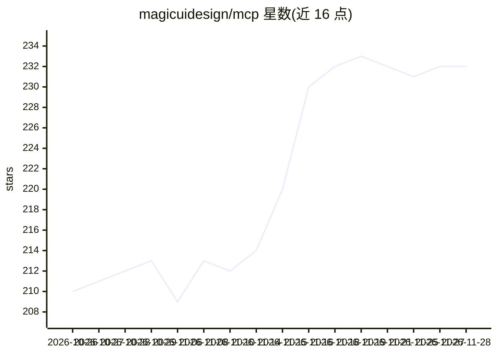

# magicuidesign/mcp

⭐ 232 · TypeScript · MIT · 推送 2026-11-27 · [GitHub](https://github.com/magicuidesign/mcp) · [官网](https://magicui.design) · 组织维护

**面向 AI 编辑器用户的 Magic UI 组件搜索与安装 MCP 服务器**

Magic UI 的官方 Model Context Protocol 服务器，为开发者提供在 AI 编辑器内检索与安装 Magic UI 组件的通道。提供两个 MCP 工具：listRegistryItems 列出组件注册表条目（支持 kind、limit、offset 参数），getRegistryItem 返回单个组件详情及安装说明、源码与示例。服务器直接读取在线 Magic UI 注册表而非硬编码分类，通过 npx 安装命令写入 IDE 的 MCP 配置。

## 筛选速览

| 维度 | 判定 | 备注 |
|---|---|---|
| AI 角色 | `ai-ecosystem` | LLM/agent 周边工具 |
| 许可风险 | `permissive` | MIT |
| 部署形态 | `library` | 以包/库形式分发 |
| 模型依赖 | — | README 未给出锁定关系 |
| 硬件要求 | — | 无带数字的原话,不猜 |
| 安装摩擦 | `low` | 无编译、无系统依赖或容器化 |
| 成熟度 | — | 结构信号不足 |

## 能力要点

- 官方 MCP 服务器，直接读取在线 Magic UI 注册表
- 两个 MCP 工具：组件列表检索与单组件详情查询
- 支持 cursor/windsurf/claude/cline/roo-cline 五种客户端的一键配置

## 适用场景

- 在 AI 编辑器中用自然语言请求 Magic UI 组件并获取安装方式
- 检索 Magic UI 注册表中的组件、源码与示例

## 场景标签

`代码生成` · 领域:编码与开发

## 证据(README 行号)

> L5: Official ModelContextProtocol (MCP) server for Magic UI.
> L46: The server provides the following tools callable via MCP:

## 星数曲线

2026-10-26 210 → 2026-11-28 232（+22）

---
*卡片 v1 · prompt 1.4 · 生成 2026-11-25 · 置信度 high · 依据 README sha `dcbb2b9f1051` · [字段定义](../../DATASET.md)*
