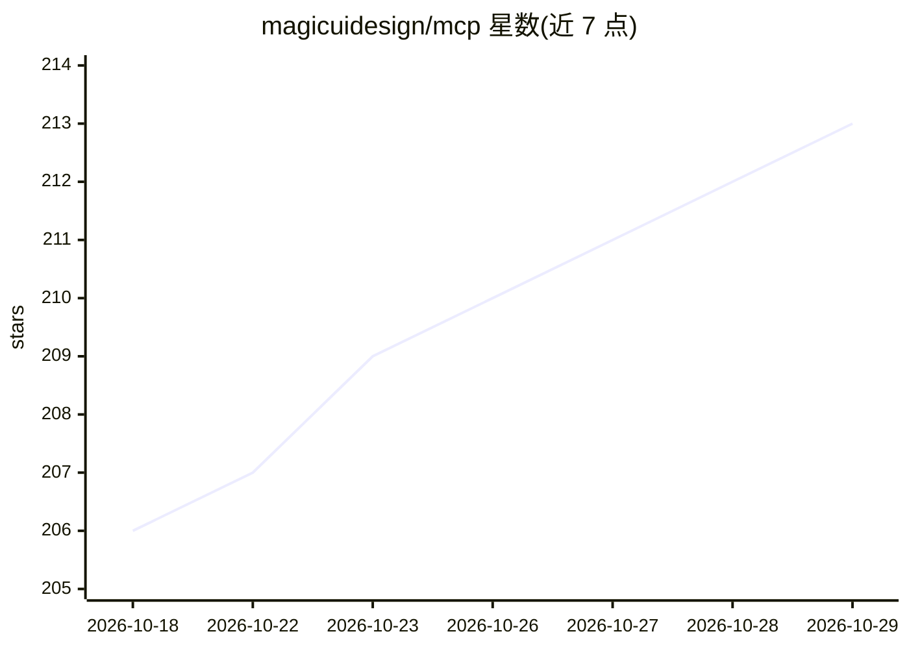

# magicuidesign/mcp

⭐ 213 · TypeScript · MIT · 推送 2026-04-07 · [GitHub](https://github.com/magicuidesign/mcp) · [官网](https://magicui.design) · 组织维护

**Magic UI 官方 MCP 服务器：在 AI 编辑器中搜索并安装 UI 组件**

Magic UI 的官方 Model Context Protocol 服务器，面向使用 AI 编辑器的开发者。配置后可在 Cursor、Windsurf、Claude、Cline、roo-cline 等客户端中通过自然语言请求浏览、检索和安装 Magic UI 注册表中的组件。提供三个 MCP 工具：listRegistryItems 按类别/关键词/分页列出条目，searchRegistryItems 跨名称、标题、描述与类型做关键词搜索，getRegistryItem 返回单个组件的详情、安装说明与示例。工具表面刻意保持精简并直接读取在线注册表，未将 widgets/media/devices 等宽泛语义概念建模为一等类别。

## 筛选速览

| 维度 | 判定 | 备注 |
|---|---|---|
| AI 角色 | `ai-ecosystem` | LLM/agent 周边工具 |
| 许可风险 | `permissive` | MIT |
| 部署形态 | `library` | 以包/库形式分发 |
| 模型依赖 | — | README 未给出锁定关系 |
| 硬件要求 | — | 无带数字的原话,不猜 |
| 安装摩擦 | `low` | 无编译、无系统依赖或容器化 |
| 成熟度 | — | 结构信号不足 |

## 能力要点

- 官方 MCP 服务器，npx 一条命令为指定客户端写入配置
- 支持 cursor/windsurf/claude/cline/roo-cline 五种客户端
- 三个 MCP 工具：列表、关键词搜索、单条目详情（含安装说明）
- 直接读取在线 Magic UI 注册表而非硬编码分类

## 适用场景

- 在 AI 编辑器里用自然语言查找 Magic UI 动画/背景组件
- 让 AI 助手直接安装指定组件到项目
- 按 kind/query/分页浏览 Magic UI 注册表

## 场景标签

 · 领域:前端开发/UI 组件

## 证据(README 行号)

> L5: Official ModelContextProtocol (MCP) server for Magic UI.
> L46: The server provides the following tools callable via MCP:

## 星数曲线

2026-10-18 206 → 2026-10-29 213（+7）

---
*卡片 v1 · prompt 1.4 · 生成 2026-10-22 · 置信度 high · 依据 README sha `09d6c623c6c8` · [字段定义](../../DATASET.md)*
