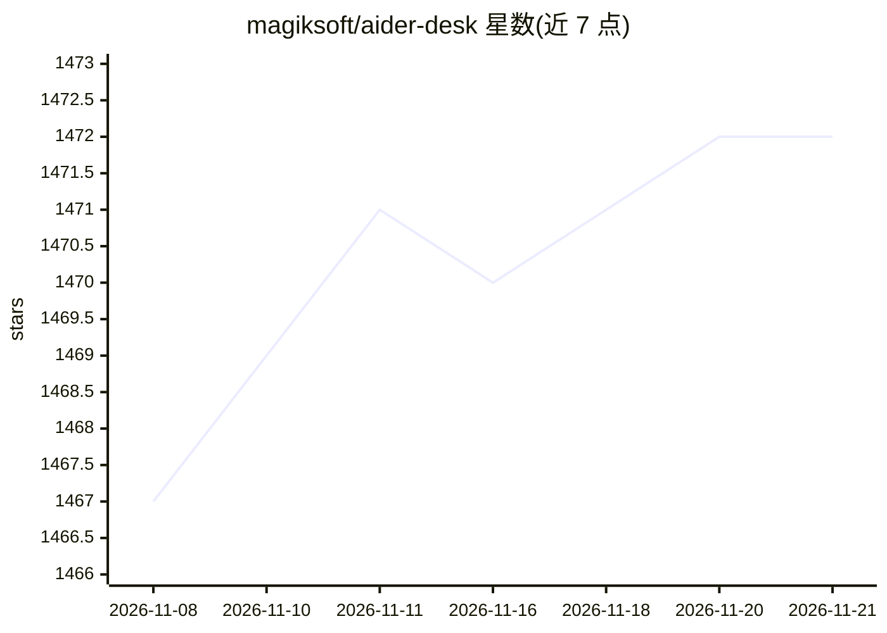

# magiksoft/aider-desk

⭐ 1,472 · TypeScript · Apache-2.0 · 推送 2026-11-20 · [GitHub](https://github.com/magiksoft/aider-desk) · [官网](https://aiderdesk.dev) · 组织维护

**面向专业软件工程师的 AI 编排桌面平台（Aider GUI 演化）**

开源 Electron 桌面应用，最初为 Aider CLI 的图形界面，现定位为 agentic 编排层：多项目/任务管理、Git worktree 隔离实验、任务分叉与聊天历史编辑、基于 LanceDB 向量嵌入的仓库语义检索、逐行 diff 审阅与工具审批门、子代理与 25+ 模型切换。支持扩展机制（生命周期钩子、自定义工具、React 组件注入）、MCP 客户端/服务端、REST API 与 IDE 插件。数据本地存储。

## 筛选速览

| 维度 | 判定 | 备注 |
|---|---|---|
| AI 角色 | `ai-native` | 本体是模型或模型工具 |
| 许可风险 | `permissive` | Apache-2.0 |
| 部署形态 | `library` | 以包/库形式分发 |
| 模型依赖 | — | README 未给出锁定关系 |
| 硬件要求 | — | 无带数字的原话,不猜 |
| 安装摩擦 | `low` | 无编译、无系统依赖或容器化 |
| 成熟度 | — | 结构信号不足 |

## 能力要点

- Git worktree 隔离多任务实验与内置合并流程
- 支持 OpenAI/Anthropic/Gemini/DeepSeek/Ollama 等 25+ 提供商
- 扩展架构：30+ 生命周期事件钩子、自定义 TypeScript 工具、React UI 注入
- 可作为 MCP 服务端暴露给 Claude Desktop、Cursor 等客户端

## 适用场景

- 在隔离的 Git worktree 中让 AI 做实验性改动并审阅后合并
- 同时管理多个代码仓库与任务的多模型 AI 辅助开发
- 通过审批门与 diff 审阅控制 AI 的每一步操作

## 场景标签

`编码 Agent` `语义搜索` · 领域:编码与开发

## 证据(README 行号)

> L23: AiderDesk is an open-source agentic platform that puts **you** back in the driver's seat of AI-assisted development

## 星数曲线

2026-11-08 1,467 → 2026-11-21 1,472（+5）

---
*卡片 v1 · prompt 1.4 · 生成 2026-11-17 · 置信度 high · 依据 README sha `30024f7473c0` · [字段定义](../../DATASET.md)*
