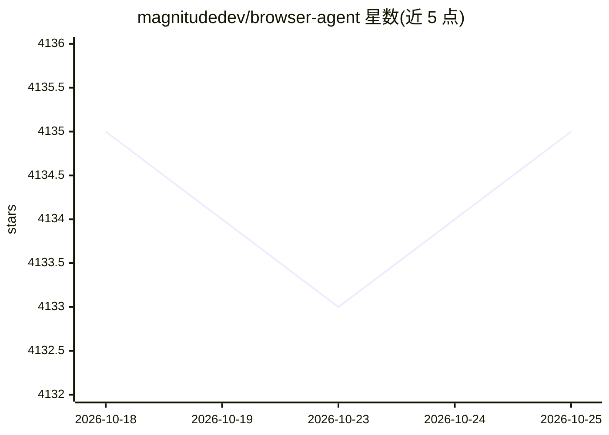

# magnitudedev/browser-agent

⭐ 4,135 · TypeScript · Apache-2.0 · 推送 2026-02-08 · [GitHub](https://github.com/magnitudedev/browser-agent) · [官网](https://magnitude.run) · 组织维护

**视觉优先的开源浏览器自动化 agent 框架**

Magnitude 是一个 vision-first 的浏览器 agent 框架：由视觉接地 LLM 输出像素坐标来规划与执行浏览器操作，支持自然语言导航、鼠标键盘交互、结构化数据提取，并内置带视觉断言的测试运行器。可用于 Web 自动化、无 API 的应用集成、数据提取、Web 测试或作为自建浏览器 agent 的构件。提供 npx 项目脚手架与 npm 测试运行器安装方式，要求使用视觉接地大模型（推荐 Claude Sonnet 4，兼容 Qwen-2.5VL 72B）；确定性缓存系统标注为开发中。

## 筛选速览

| 维度 | 判定 | 备注 |
|---|---|---|
| AI 角色 | `ai-ecosystem` | LLM/agent 周边工具 |
| 许可风险 | `permissive` | Apache-2.0 |
| 部署形态 | `library` | 以包/库形式分发 |
| 模型依赖 | — | README 未给出锁定关系 |
| 硬件要求 | — | 无带数字的原话,不猜 |
| 安装摩擦 | `low` | 无编译、无系统依赖或容器化 |
| 成熟度 | `idea` | |

## 能力要点

- 视觉优先架构：LLM 输出像素坐标，独立于 DOM 结构
- 内置测试运行器，支持视觉断言
- 支持高层任务（act）与细粒度动作两级抽象，可自定义动作与提示
- 可提取结构化数据、在无 API 的应用间做集成

## 适用场景

- 用自然语言自动化网页操作任务
- 为自己的 Web 应用编写带视觉断言的测试并接入 CI/CD
- 从网页提取结构化数据
- 作为构建自研浏览器 agent 的基础组件

## 场景标签

`浏览器自动化` `Agent 框架` `网页抓取` · 领域:Agent 开发

## 证据(README 行号)

> L9: Magnitude uses vision AI to enable you to control your browser with natural language.
> L15: You can use it to automate tasks on the web, integrate between apps without APIs, extract data, test your web apps,
> L49: > Magnitude requires a large **visually grounded** model. We recommend Claude Sonnet 4 for the best performance, bu

## 星数曲线

2026-10-18 4,135 → 2026-10-25 4,135（+0）

---
*卡片 v1 · prompt 1.4 · 生成 2026-10-20 · 置信度 high · 依据 README sha `912bbde2bce3` · [字段定义](../../DATASET.md)*
