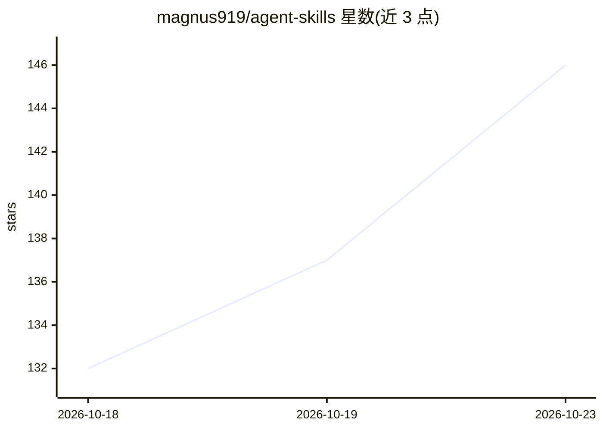

# magnus919/agent-skills

⭐ 146 · Python · MIT · 推送 2026-10-21 · [GitHub](https://github.com/magnus919/agent-skills) · 个人维护

**AI agent 技能集合：多领域可复用工作流与知识包**

遵循 Agent Skills 开放格式的技能仓库，收录覆盖精算建模、AI 治理、agent 评测与生产运维、后端工程、品牌设计、CRM/Confluence 命令行操作等领域的可复用工作流、协议与知识包，兼容任何支持该标准的 agent 框架（如 AutoGen、CrewAI）。作者同时在此沉淀让 agent 更可治理、可观测的实践模式。部分技能附带 CLI、模板与评测（如 agent-council 提供 pip 安装包）。

## 筛选速览

| 维度 | 判定 | 备注 |
|---|---|---|
| AI 角色 | `ai-knowledge` | 知识聚合/清单类 |
| 许可风险 | `permissive` | MIT |
| 部署形态 | `self-host` | docker 或自建部署 |
| 模型依赖 | — | README 未给出锁定关系 |
| 硬件要求 | — | 无带数字的原话,不猜 |
| 安装摩擦 | `low` | 无编译、无系统依赖或容器化 |
| 成熟度 | — | 结构信号不足 |

## 能力要点

- 条目遵循 Agent Skills 开放格式，兼容支持该标准的任意框架
- 覆盖 AI 治理、评测、生产运维、多智能体协作等领域的技能
- 部分技能自带 CLI、模板与评测场景（如 cncf-landscape、capacity-and-cost-engineering）
- 含 PydanticAI 构建的多智能体辩论包 agent-council（pip 可安装）

## 适用场景

- 为我的 agent 框架查找特定领域的可复用技能
- 搭建 AI 治理、评测与生产运维相关的 agent 工作流
- 参考技能格式编写自己的 Agent Skills

## 场景标签

`精选清单` · 领域:学习与行业

## 证据(README 行号)

> L5: A collection of AI agent skills — reusable workflows, protocols, and knowledge packs for agentic systems. Skills fol
> L7: The project is also where I codify practical patterns for making agents more capable, governable, observable, and tr

## 星数曲线

2026-10-18 132 → 2026-10-23 146（+14）

---
*卡片 v1 · prompt 1.4 · 生成 2026-10-23 · 置信度 mid · 依据 README sha `d7284af53e50` · [字段定义](../../DATASET.md)*
