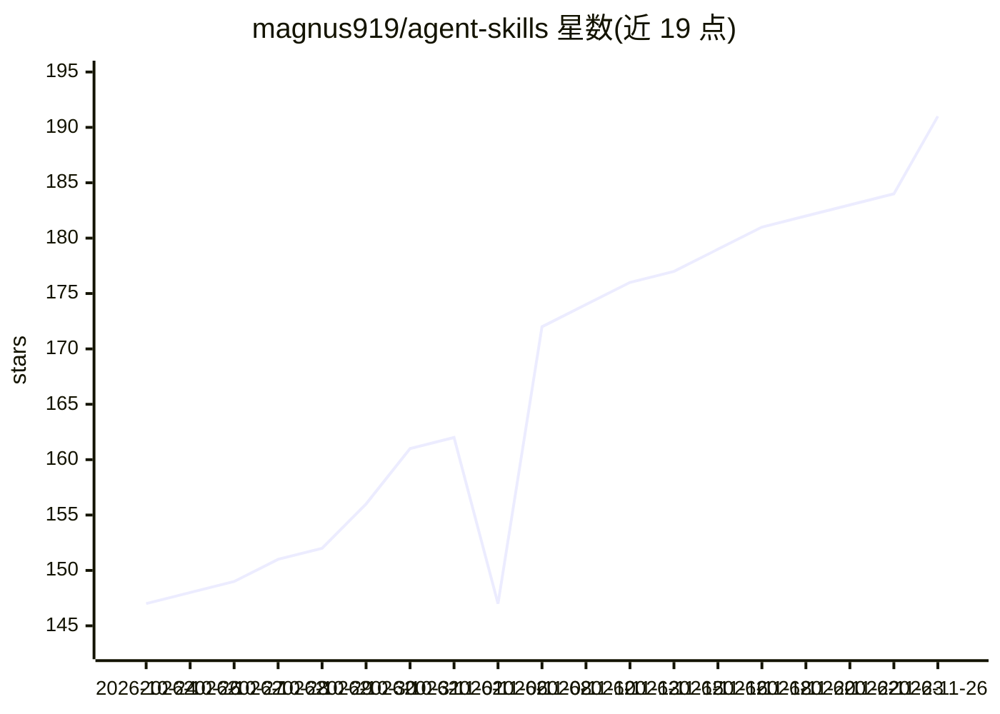

# magnus919/agent-skills

⭐ 191 · Python · MIT · 推送 2026-11-25 · [GitHub](https://github.com/magnus919/agent-skills) · 个人维护

**面向 agent 框架的可复用技能合集与工程方法库**

按 Agent Skills 开放格式组织的技能合集，覆盖软件交付流程（实现规划、代码评审、系统化调试、验证交付）、AI 治理与运营经济学、多智能体协调、agent 评测与可观测性、生产运行控制面等领域，并以任务决策表引导按需选用。技能声明为格式开放、可兼容任何支持该标准的框架；另含部分打包为可安装 Python 包的子项。仓库由个人维护，附安装与更新目录的方式。

## 筛选速览

| 维度 | 判定 | 备注 |
|---|---|---|
| AI 角色 | `ai-knowledge` | 知识聚合/清单类 |
| 许可风险 | `permissive` | MIT |
| 部署形态 | `self-host` | docker 或自建部署 |
| 模型依赖 | — | README 未给出锁定关系 |
| 硬件要求 | — | 无带数字的原话,不猜 |
| 安装摩擦 | `low` | 无编译、无系统依赖或容器化 |
| 成熟度 | — | 结构信号不足 |

## 能力要点

- 技能遵循 Agent Skills 开放格式，兼容支持该标准的框架
- 按任务决策表索引（从要做的决策/工作出发选择技能）
- 覆盖评测、发布门禁、运行控制面、AI 治理、运营经济学等主题
- 部分技能以 pip 可安装 Python 包形式分发

## 适用场景

- 为支持 Agent Skills 格式的 agent 框架补充工作流技能
- 为 AI agent 系统设计评测、发布门禁与可观测性方案
- 建立组织的 AI 治理与运营经济决策流程
- 规范多智能体协作与变更交付的权限边界

## 场景标签

`Agent 框架` `多智能体` · 领域:Agent 开发

## 证据(README 行号)

> L5: A collection of AI agent skills — reusable workflows, protocols, and knowledge packs for agentic systems. Skills fol
> L13: Start with the decision or job you have. These are links to existing skills, not

## 星数曲线

2026-10-24 147 → 2026-11-26 191（+44）

---
*卡片 v1 · prompt 1.4 · 生成 2026-11-26 · 置信度 low · 依据 README sha `897f0ccaaf00` · [字段定义](../../DATASET.md)*
