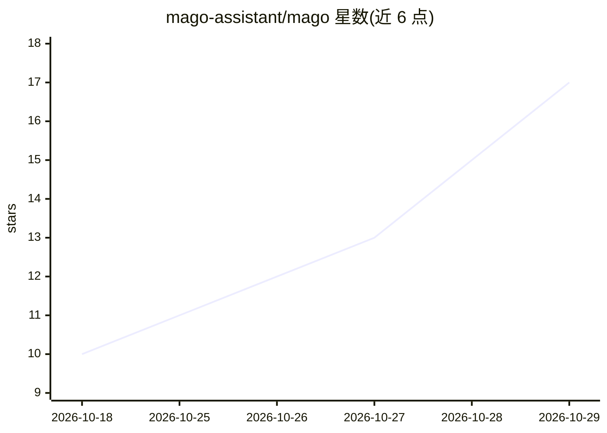

# mago-assistant/mago

⭐ 17 · PHP · MIT · 推送 2026-10-28 · [GitHub](https://github.com/mago-assistant/mago) · 组织维护

**Magento 2 / Mage-OS 商店管理员的 AI 聊天助手**

以 Composer 模块形式安装进 Magento 管理后台的聊天助手：用自然语言查询本店实时数据（销售、商品、客户、配置、内容），并可执行配置修改、缓存清理、重建索引、取消订单等写操作——所有写入需确认，不可逆操作先展示影响，读写均经 Magento ACL 按管理员角色控制。支持自带 key 接入 Anthropic、OpenAI、Azure、Gemini、DeepSeek、Ollama、OpenRouter 等多种提供商，另有斜杠命令（不经 AI）、浏览器语音输入（默认关闭）与基于 MySQL FULLTEXT 的官方文档问答。要求 PHP ≥8.2、Magento ≥2.4.8 或 Mage-OS ≥1.1，需至少一个提供商的 API key。

## 筛选速览

| 维度 | 判定 | 备注 |
|---|---|---|
| AI 角色 | `ai-native` | 本体是模型或模型工具 |
| 许可风险 | `permissive` | MIT |
| 部署形态 | `library` | 以包/库形式分发 |
| 模型依赖 | local-ok | 支持本地模型 |
| 硬件要求 | — | 无带数字的原话,不猜 |
| 安装摩擦 | `low` | 无编译、无系统依赖或容器化 |
| 成熟度 | — | 结构信号不足 |

## 能力要点

- 自然语言读写本店实时数据，写操作一律先确认并经 Magento ACL 控制
- 多提供商支持：Anthropic/OpenAI/Azure/Gemini/DeepSeek/Ollama/OpenRouter 等，请求直连提供商
- 斜杠命令（/cache flush、/index reindex 等）不经 AI 直接执行
- 文档问答：cron 索引官方文档到 MySQL FULLTEXT 并引用来源页

## 适用场景

- 问'本周卖得最好的是什么'并得到带图表的实时回答
- 用一句话让助手改配置、清缓存或重建索引，写操作需我确认
- 按我的管理员角色权限查询销售、库存与客户数据
- 让助手基于官方文档回答后台操作问题

## 场景标签

`聊天机器人` `文档问答` · 领域:对话与助手

## 证据(README 行号)

> L5:  The free, open source AI admin assistant for Magento 2 and Mage-OS.
> L25: Type a question in plain language and Mago answers with **live data from your own store** —
> L27: **does it for you**, but only after you've confirmed. It streams its answer as it works, shows

## 星数曲线

2026-10-18 10 → 2026-10-29 17（+7）

---
*卡片 v1 · prompt 1.4 · 生成 2026-10-29 · 置信度 mid · 依据 README sha `5ce1c28b67cb` · [字段定义](../../DATASET.md)*
