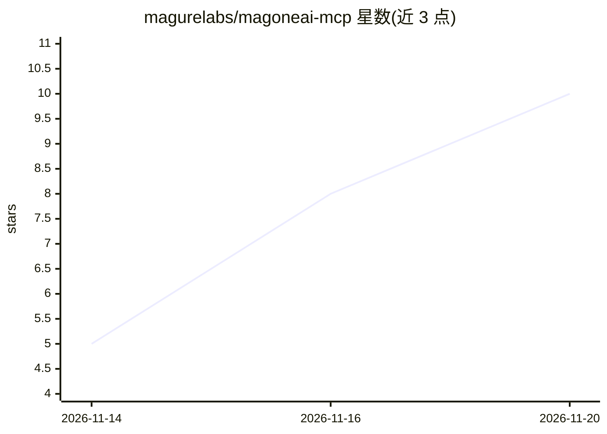

# magurelabs/magoneai-mcp

⭐ 10 · Python · Apache-2.0 · 推送 2026-11-19 · [GitHub](https://github.com/magurelabs/magoneai-mcp) · 组织维护

**为 AI agent 提供第三方 API 的 MCP 连接器集合（27 个连接器、283 个工具）**

基于官方 MCP Python SDK 构建的第三方 API 连接器仓库，含 magone-mcp-core 框架层与 connectors/ 下的 27 个连接器（共 283 个工具）。连接器以 MCP over Streamable HTTP 提供，凭证经 HTTP 头或 JSON 文件传入，支持本地、容器、platform/hosted 认证模式。框架统一提供输出预算、只读模式、SSRF 校验、凭证脱敏日志、Host/Origin 白名单与健康检查端点；连接器需从源码检出运行，发布版 wheel 仅含框架包。

## 筛选速览

| 维度 | 判定 | 备注 |
|---|---|---|
| AI 角色 | `ai-ecosystem` | LLM/agent 周边工具 |
| 许可风险 | `permissive` | Apache-2.0 |
| 部署形态 | `self-host` | docker 或自建部署 |
| 模型依赖 | — | README 未给出锁定关系 |
| 硬件要求 | — | 无带数字的原话,不猜 |
| 安装摩擦 | `low` | 无编译、无系统依赖或容器化 |
| 成熟度 | — | 结构信号不足 |

## 能力要点

- 27 个连接器、283 个工具，基于官方 MCP Python SDK
- 凭证经 HTTP 头或 MCP_CREDENTIALS_PATH JSON 文件声明，含防 SSRF 与凭证脱敏日志
- 框架层统一保证：输出预算、只读模式、DNS-rebinding 防护、健康端点
- 单个 Docker 镜像经构建参数选择连接器，以非 root 用户运行

## 适用场景

- 为 MagOneAI 或其他 MCP host 接入 Linear、Atlassian、Google Workspace 等第三方 API
- 自托管 MCP 服务器并按头/文件方式管理 API 凭证
- 按 permission group 缩窄某连接暴露给单个连接的工具集

## 场景标签

`Agent 框架` · 领域:Agent 开发

## 证据(README 行号)

> L8: MCP connectors for third-party APIs, built on the official MCP Python SDK.
> L14: MagOneAI is Magure's AI agent workflow platform: teams define agents with a persona and tools, place them in multi-
> L34: - **`connectors/`** - one package per connector: 27 connectors, 283 tools. `docs/TOOLS.md` lists every tool, genera

## 星数曲线

2026-11-14 5 → 2026-11-20 10（+5）

---
*卡片 v1 · prompt 1.4 · 生成 2026-11-20 · 置信度 high · 依据 README sha `71c5d8f6311f` · [字段定义](../../DATASET.md)*
