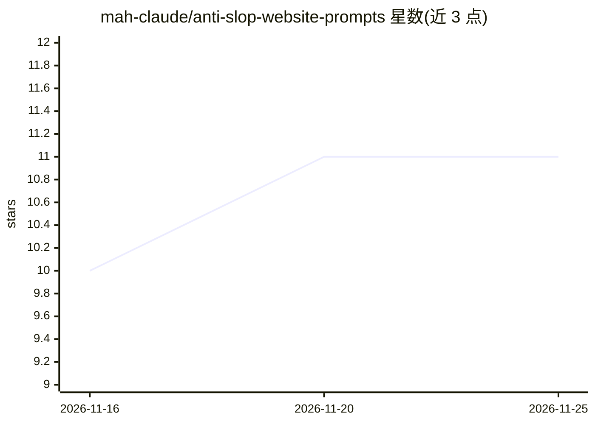

# mah-claude/anti-slop-website-prompts

⭐ 11 · MIT · 推送 2026-08-03 · [GitHub](https://github.com/mah-claude/anti-slop-website-prompts) · [官网](https://meez.design) · 组织维护

**为 AI 建站工具提供的 15 条网站构建提示词与反模板化设计技能**

由 Meez (meez.design) 维护的开源提示词库：提供 15 条完整的艺术指导式建站 prompt（含具体字体、色彩 token、结构化布局、动效规格与真实素材 URL），可粘贴到 Lovable、Bolt、v0、Cursor 或 Claude Code 中生成设计化网站；另附可安装到 Claude Code 的 SKILL.md，教会 agent 五项规格化设计习惯（指定字体、token 化配色、结构化布局、明确动效、接入真实素材）。prompt 文本可商用免署名，仓库本体 MIT 许可；更多 prompt 位于站点的付费库（$19/mo 起）。

## 筛选速览

| 维度 | 判定 | 备注 |
|---|---|---|
| AI 角色 | `ai-knowledge` | 知识聚合/清单类 |
| 许可风险 | `permissive` | MIT |
| 部署形态 | `None` |  |
| 模型依赖 | — | README 未给出锁定关系 |
| 硬件要求 | — | 无带数字的原话,不猜 |
| 安装摩擦 | `low` | 无编译、无系统依赖或容器化 |
| 成熟度 | — | 结构信号不足 |

## 能力要点

- 15 条完整可商用、免署名的艺术指导式建站 prompt
- SKILL.md 提供五项反模板化设计规格习惯，可安装到 Claude Code 或粘贴进 Cursor 规则
- 每条 prompt 附示例文件与在线预览链接
- prompt 为工具无关的纯文本，支持五种 AI 建站工具

## 适用场景

- 让 AI 建站工具生成非模板化的落地页/应用界面
- 为 Claude Code 安装设计规范技能，约束任意项目的产出风格
- 复制 prompt 后替换文案与素材快速搭建客户网站

## 场景标签

`提示工程` · 领域:Agent 开发

## 证据(README 行号)

> L7: > **What this is:** 15 free, complete, art-directed **AI website build-prompts** (full text, commercial use OK) plus
> L17: ## The 15 free prompts
> L66: `SKILL.md` teaches an agentic coding tool the **five specification habits** that kill generic output, so it applies

## 星数曲线

2026-11-16 10 → 2026-11-25 11（+1）

---
*卡片 v1 · prompt 1.4 · 生成 2026-11-20 · 置信度 high · 依据 README sha `51b0b8ad2d5a` · [字段定义](../../DATASET.md)*
