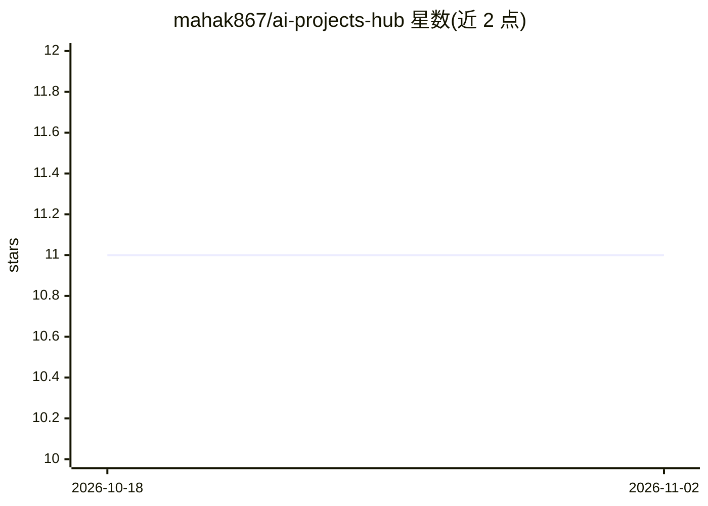

# mahak867/ai-projects-hub

⭐ 11 · Python · MIT · 推送 2026-04-19 · [GitHub](https://github.com/mahak867/ai-projects-hub) · 个人维护

**20 个可运行 AI 项目合集：RAG、agent、自动化与印度市场工具**

面向学习者的 Python + Claude 项目集合，收录 20 个带完整代码的项目，覆盖 PDF 问答、多 agent 流水线、RAG、AI 代码审查、语音日记、面试教练等；其中 7 个项目围绕 NSE/BSE 股票数据、卢比计价与印度市场结构构建（自述 India-first）。每个项目目录固定含可运行主脚本、requirements.txt 与 README。使用需 Python 3.10+ 与 Claude API key（console.anthropic.com），通过 git clone 源码运行。

## 筛选速览

| 维度 | 判定 | 备注 |
|---|---|---|
| AI 角色 | `ai-knowledge` | 知识聚合/清单类 |
| 许可风险 | `permissive` | MIT |
| 部署形态 | `library` | 以包/库形式分发 |
| 模型依赖 | locked-api |  |
| 硬件要求 | — | 无带数字的原话,不猜 |
| 安装摩擦 | `low` | 无编译、无系统依赖或容器化 |
| 成熟度 | — | 结构信号不足 |

## 能力要点

- 20 个项目按初级/中级/高级组织，含可运行代码
- 7 个 India-first 金融项目（NSE/BSE 数据、₹ 计价）
- 项目覆盖 RAG、MCP 服务器、多 agent、Claude computer use 等用法
- 每目录固定三件套：主脚本 + requirements.txt + README

## 适用场景

- 我想动手跑通 RAG、多 agent 等 AI 项目的完整代码来学习
- 我想用 AI 分析 NSE/BSE 印度股票数据
- 我想搭建简历匹配分析、YouTube 总结等可用的小工具

## 场景标签

`RAG` `多智能体` `金融量化` `教程课程` · 领域:Agent 开发

## 证据(README 行号)

> L17: ## ⭐ Featured Projects
> L92: ## 📦 Projects
> L200: ## 🏗️ Structure

## 星数曲线

2026-10-18 11 → 2026-11-02 11（+0）

---
*卡片 v1 · prompt 1.4 · 生成 2026-11-02 · 置信度 mid · 依据 README sha `823521cf6f2a` · [字段定义](../../DATASET.md)*
