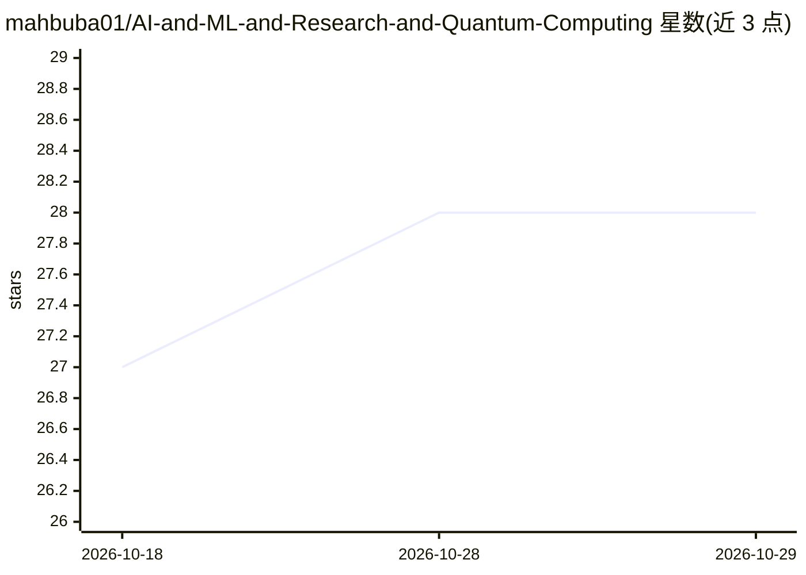

# mahbuba01/AI-and-ML-and-Research-and-Quantum-Computing

⭐ 28 · MIT · 推送 2026-06-21 · [GitHub](https://github.com/mahbuba01/AI-and-ML-and-Research-and-Quantum-Computing) · 个人维护

**个人维护的 AI/ML/量子计算科普知识笔记仓库**

README 形式的学习笔记与科普文章合集：涵盖 AI 聊天机器人历史（ELIZA）、搜索策略（BFS/DFS/A*）、生成式 AI 与 Agentic AI 的主题清单及入门路径、量子计算原理（叠加/纠缠/干涉）与进展、Chrome 期刊排名扩展介绍，以及使用 Elsevier Journal Finder 选刊和 APC 费用说明。内容为知识性文本，无可运行代码、无安装命令，面向学习者和科研人员阅读。

## 筛选速览

| 维度 | 判定 | 备注 |
|---|---|---|
| AI 角色 | `ai-knowledge` | 知识聚合/清单类 |
| 许可风险 | `permissive` | MIT |
| 部署形态 | `None` |  |
| 模型依赖 | — | README 未给出锁定关系 |
| 硬件要求 | — | 无带数字的原话,不猜 |
| 安装摩擦 | `low` | 无编译、无系统依赖或容器化 |
| 成熟度 | — | 结构信号不足 |

## 能力要点

- 生成式 AI 与 Agentic AI 的主题式学习路径清单
- 量子计算三原理与 2025 年前进展综述
- 学术论文选刊与 APC 费用/减免指引

## 适用场景

- 系统了解生成式 AI 与 Agentic AI 应学主题
- 入门量子计算基本概念与行业进展
- 查找适合投稿的学术期刊并了解费用政策

## 场景标签

`教程课程` · 领域:学习与行业

## 证据(README 行号)

> L3: The world’s first famous AI chatbot was created in 1966 — long before the internet existed!
> L108: # Guidelines of Agentic AI
> L161: # Quantum Computing

## 星数曲线

2026-10-18 27 → 2026-10-29 28（+1）

---
*卡片 v1 · prompt 1.4 · 生成 2026-10-26 · 置信度 high · 依据 README sha `ce17057c2f8a` · [字段定义](../../DATASET.md)*
